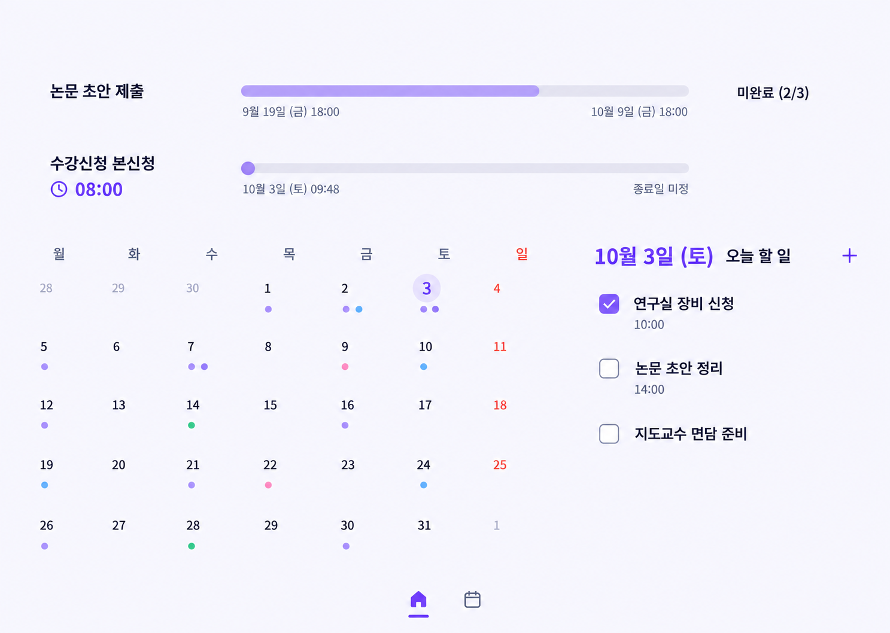
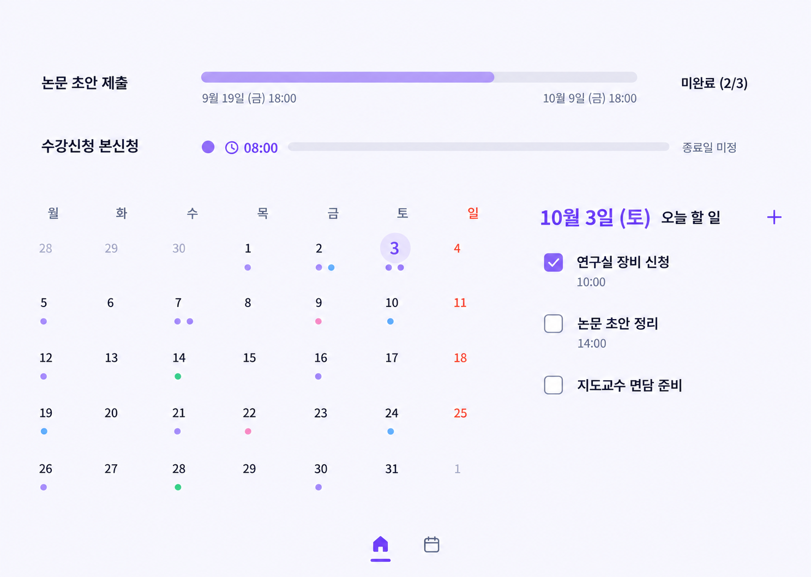
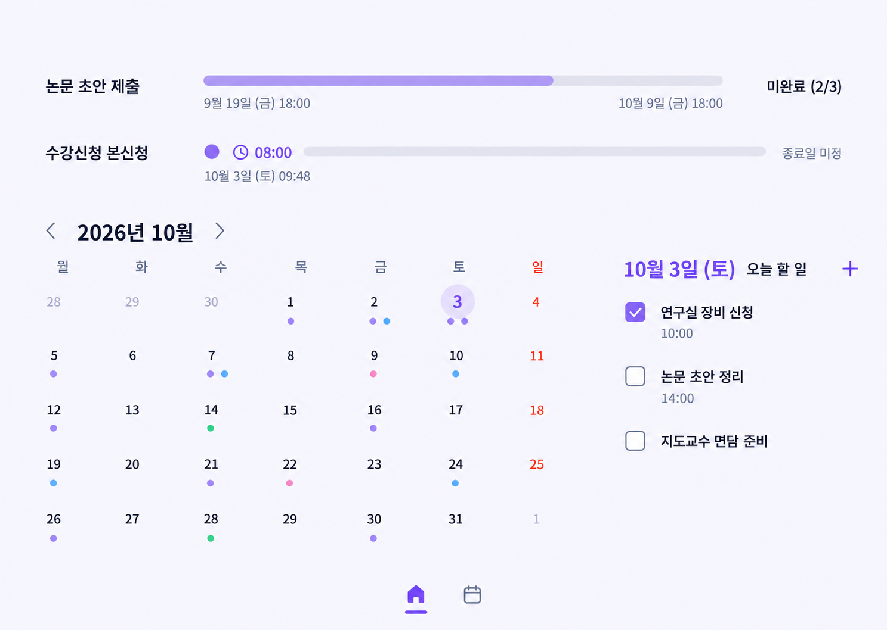

# 03 — UX / 프론트엔드 사양

- 문서 상태: 최신 시안 1번 「경계 없는 월간」을 선택했다. 순백 배경과 라벤더 포인트를 사용하며 데스크톱·iOS 대응 화면을 Figma에 구성했다.
- 기준일: 2026-10-03, Asia/Seoul.
- 기본 언어·시간대: 한국어, Asia/Seoul. 시간대가 명시된 이벤트는 이벤트 시간대를 우선한다.
- 이 문서는 UX 동작과 프론트엔드 표현을 정한다. 서비스 경계와 보안 규칙은 백엔드 설계 문서에서 구체화하고, 검증 절차는 검증 문서에서 추적한다.

## 2026-10-05 보드형 기간 영역 결정

현재 구현 기준은 앞선 두 행 고정안보다 최신 사용자 결정을 우선한다. 홈의 상단에는 긴급 순서의 기간 카드를 최대 세 개까지 한 줄로 보인다. `더 보기`를 누르면 팝오버가 기간 영역의 맨 위에서 떠올라 접힌 화면의 카드 3개를 덮고, 전체 기간 항목을 데스크톱 3열 격자에 정렬한다. 모바일에서는 같은 격자를 한 열로 접는다. 배경 달력은 밀리지 않고 패널 뒤에 남는다. 팝오버는 흰 표면과 부드러운 그림자를 사용하며 안쪽 우측 아래에서 접을 수 있다. 기간은 시간 상태에 따라 예정 파랑(`#5F83D8`), 진행 중 라벤더(`#6E4DF5`), 종료 회색(`#A4A6AF`)을 사용한다. 예정 기간은 켜진 카운트다운의 노출 구간에서 시작 시점까지 바가 파랗게 차며, 카운트다운 표시가 꺼졌거나 설정이 0일이면 파란 시작점만 표시한다. 진행 중은 알려진 시작·종료가 모두 있을 때만 경과율을 채우고, 경계가 빠진 경우 상태색 track만 사용한다. 기간 종료는 회색 track/fill로 표시한다. 시작·끝 날짜, 설정된 카운트다운, 하위 할 일 상태는 색과 별개로 유지한다. 완료된 하위 할 일은 바깥 체크박스로 반복하지 않는다.

## 제품 범위와 제약

### 고정된 선택

- Next.js 16 정적 내보내기와 Firebase Hosting/Auth/Firestore Spark를 사용한다. 동적 서버 route, Server Action, 서버 작업 스케줄러는 V1에 없다.
- macOS와 iOS에서 PWA를 먼저 제공한다. iOS 네이티브 앱은 후속 로드맵이다.
- 실제 첫 이용자는 소유자 한 명이지만 다른 Google 계정도 가입할 수 있다. 각 계정은 자기 UID의 데이터만 본다. 공유 캘린더·그룹·친구 피드는 범위 밖이다.
- 홈(/)은 TodoMate식 월간 할 일 화면이다. 날짜별 하루 할 일을 날짜 칸에 표시하고 선택 날짜 목록에서 수행한다. 기간형 마감·신청 항목은 월간 할 일 칸에 넣지 않고 홈 상단에 다음 시간 경계가 가까운 미완료 항목 최대 세 개를 표시한다. 자동 캐러셀/밀어올리기 없이 초과 항목은 클릭 시 홈을 밀지 않는 3열 오버레이에서 연다.
- 주간·월간 캘린더는 별도 페이지(/calendar)다. 이 페이지에서 하루 할 일, 기간형 항목, 일반 고정 일정을 함께 탐색한다. 고정 수업·미팅은 홈의 할 일 칸이나 선택 날짜 할 일 목록에 섞지 않는다.
- 기간 바는 시작부터 종료까지의 시간 경과를 시각적으로 나타내며, 눈에 보이는 날짜/시각은 바의 양 끝에만 둔다. 하위 체크리스트 상태는 바 우측의 텍스트로 별도 표시하고 진행 요약 안에 체크박스나 하위 할 일 행을 반복하지 않는다. 제출/신청 자체 완료는 다른 상태다.
- 시작 시각이 있는 기간형 항목은 시작 카운트다운 표시가 기본 켜짐이며 기본 노출 시점은 하루 전이다. 항목별로 표시를 끄거나 0~30일 전으로 조정한다. 기기 알림은 표시 설정과 별도이며 설정에서 선택할 수 있고 기본 꺼짐이다. Firebase가 없는 로컬 미리보기에서는 항목별 알림 시각과 전체 설정을 브라우저에 저장하고, 앱이 열려 있는 동안에만 browser notification을 확인한다.
- 직접 입력과 ICS 일회성 가져오기를 지원한다. 구독형 외부 캘린더, 양방향 동기화, 교육기관 포털 자동 수집은 제공하지 않는다.
- 시작 카운트다운을 표시하는 것만으로 알림 권한을 요청하지 않는다. 로컬 미리보기 알림은 사용자가 전체 설정과 항목별 시각을 켰을 때만 동작한다. 닫힌 앱의 예약 알림, Firebase 알림과 네이티브 OS 알림은 후속 범위다.

- 공통 화면 셸에는 앱명·검색 필드가 있는 상단 앱 헤더를 두지 않는다. 홈/캘린더 이동은 하단 중앙의 아이콘 전용 바로 옮기며, 아이콘의 접근성 이름은 보조기술에 제공한다.
- 화면 배경은 순백색 #FFFFFF로 통일한다. 라벤더는 선택 날짜와 진행 표시 같은 포인트에만 쓰고 카드 테두리·상자형 셀 대신 여백, 정렬, 글자 크기와 작은 일정 점으로 구분한다.

### 정보 단위와 의미

저장 계약은 event/task/deadline/window 네 종류를 유지한다. 생성 화면에서는 하루 할 일, 기간형 항목, 고정 일정의 흐름으로 묶으며 기간형 항목 안에서 마감과 신청 기간을 구분한다.

| 사용자 흐름 | 저장 의미 | 필수 정보와 상태 | 홈·캘린더 표현 |
|---|---|---|---|
| 하루 할 일 | task | 제목, 선택 날짜/마감, 명시적 미완료/완료 | 날짜가 있으면 홈의 해당 월간 칸과 선택 날짜 목록, 날짜 미정이면 전체 할 일 목록 |
| 기간형 마감 | deadline | 제목, 마감 날짜/시각, 선택적 시작, 제출 완료 상태, checklist | 홈 상단 기간 영역과 별도 캘린더. 날짜별 할 일 칸에는 표시하지 않음 |
| 기간형 신청 | window | 제목, 시작 날짜/시각, 아는 경우 종료, 신청 완료 상태, checklist | 홈 상단 기간 영역과 별도 캘린더. 날짜별 할 일 칸에는 표시하지 않음 |
| 고정 일정 | event | 제목, 시작과 종료. 날짜형 종료일 포함 | 별도 캘린더 페이지에만 표시. 완료 체크박스 없음 |

기간형 항목의 checklist 완료 상태는 제출/신청 자체의 완료 상태와 다른 값이다. 화면에서는 하위 할 일 상태를 기간 바 옆에 표시하고, 제출 완료/신청 완료와 혼동하지 않도록 설명 라벨을 함께 둔다. 하위 할 일이 없으면 하위 완료 상태를 표시하지 않는다. 한 개일 때는 미완료 또는 완료, 둘 이상일 때 일부가 남으면 미완료(남은 수/전체 수), 모두 끝났으면 완료를 표시한다. 완료 후 새 하위 할 일을 추가하면 파생 상태는 다시 미완료가 된다.

날짜형 마감은 해당 시간대의 달력 날짜로 처리하며 임의로 23:59를 저장하지 않는다. 날짜와 시각을 넣지 않은 항목은 날짜 미정으로 표시한다. 정확한 시작만 아는 정시 오픈에는 종료 시각 미정 상태를 허용하며 접수 종료나 기간 바를 추측하지 않는다.

날짜형 event의 종료일은 포함하고 시간형 event는 시작/종료 instant를 사용한다. event는 양쪽 경계가 필수다. 시간 바는 기간형 마감/신청에서 신뢰할 수 있는 시작과 종료가 모두 있을 때만 계산한다. 시작 또는 종료가 없을 때는 바 대신 D-Day/시각을 표시한다.

D-Day는 항목 시간대의 달력 날짜 차이, 시작 카운트다운은 실제 instant 차이로 계산한다. 시작까지 하루 이상이면 D-N, 하루 미만이면 HH:MM, 10분 미만이면 MM:SS로 표시한다. 2026-10-03 09:40 Asia/Seoul 기준 09:48 오픈은 08:00, 10-09 날짜 마감은 D-6이다. 9-19 18:00부터 10-09 18:00까지의 시간 바는 약 68% 경과다.

## 화면 정보 구조

### 데스크톱 1440×1024

홈은 TodoMate의 월간 날짜 배치와 선택 날짜 목록을 참고한다. 앱명·검색·프로필이 놓이는 전역 상단 바 없이 기간 영역부터 시작한다. 홈의 월간 날짜 영역이 가장 넓고 선택 날짜 할 일은 오른쪽에 둔다. 상단에는 다음 관련 시각 경계가 가까운 미완료 기간 카드를 최대 세 개 고정한다. 초과분은 캘린더를 밀지 않는 팝오버에서 전체 기간과 함께 보여준다.

- 각 기간 행은 제목과 바, 양 끝 날짜/시각을 유지한다. 상태가 하나면 제목 오른쪽에 짧게 표시한다. 시작 카운트다운과 체크리스트 상태가 모두 있을 때는 카운트다운을 제목 오른쪽, 하위 완료 상태를 바의 오른쪽 끝에 나눠 표시한다. 좁은 화면에서는 상태가 보이도록 바 길이를 줄인다. 두 정보를 숨기거나 중복 문구를 보태지 않는다. 진행 퍼센트·남은 일수 문구와 기간 상세 체크박스는 두지 않으며, 실제 하루 할 일 체크박스는 선택 날짜 목록에만 둔다.
- 상단 기간 행은 아이템의 카운트다운 초 단위 변화에 따라 정렬되거나 다른 아이템으로 바뀌지 않는다. 의미 있는 상태 변화가 생기면 순서를 다시 계산하고 두 표시 자리를 채운다. 시작일이 미래인 마감/신청은 시작 시각, 진행 중인 마감은 마감 시각, 진행 중인 신청은 알려진 종료 시각을 기준으로 가까운 순서로 놓는다. 미완료 기한 경과 항목은 예정·진행 중 항목 다음에 최근 경과 순으로 사용하고, 완료 항목은 기본 홈 요약에서 제외한다.
- 월간 달력은 날짜 숫자와 작은 할 일 점을 7열로 정렬하되 각 날짜에 테두리나 배경 상자를 그리지 않는다. 선택일은 부드러운 원형 강조와 텍스트로 구분한다.
- 선택 날짜 할 일은 우측의 한 목록으로 보여준다. 실제 하루 할 일의 완료 체크박스는 이 목록에만 둔다. 목록 제목 옆의 `+` 하나가 할 일/기간 추가 메뉴를 연다. 별도의 헤더 추가 버튼은 만들지 않는다.
- 고정 수업·미팅과 주간/월간 전체 일정은 별도 `/calendar` 페이지에서 확인한다.
- 홈/캘린더/프로필 이동은 화면 하단 중앙의 세 아이콘으로 제공한다. 프로필 아이콘은 기존 `/settings`에서 계정·동기화·가져오기 설정을 연다. 시각 레이블은 감추되 접근성 이름, 선택 상태, 키보드 포커스와 44×44px 이상의 조작 영역을 유지한다.

### 중간 너비 768–1439px

기간 요약은 같은 위계를 유지하고, 월간 달력과 선택 날짜 할 일을 두 열로 배치한다. 좁은 폭에서는 할 일 목록의 줄바꿈과 달력의 날짜 셀 폭을 확인하고, 날짜별 작업 제목은 표시 수를 줄여 숨긴 건수를 알린다. 페이지 상단에는 제품명이나 검색이 있는 고정 앱 헤더를 추가하지 않는다. 하단 중앙 아이콘 내비게이션은 유지한다.

### 모바일 390×844

월간 할 일 홈은 상단 앱 헤더 없이 날짜/월 조작에서 시작하고 세로 스크롤을 지원한다.

- 순서는 상단 기간 카드 최대 세 개 → 필요한 경우 같은 카드를 모두 보여주는 오버레이 → 월간 날짜·할 일 점 → 선택 날짜 할 일이다. 초과 카드는 뒤 화면을 가리며 캘린더를 아래로 밀지 않고, 자동 회전·밀어올리기는 하지 않는다. 버튼은 남은 미완료 항목 수만 보여주고 중복 countdown이나 기간 정보를 덧붙이지 않는다.
- 날짜는 현재 Figma와 맞춰 일요일 시작으로 최대 6주 표시한다. 개별 날짜 상자와 칸 테두리를 그리지 않고 작은 일정 점과 날짜 텍스트로 밀도를 줄인다.
- 선택 날짜의 실제 할 일 체크박스는 월간 날짜 아래 목록에만 둔다. 새 항목은 해당 목록 제목 옆의 단일 `+`에서 추가한다.
- 하단 중앙에는 현재 Figma처럼 홈·캘린더·프로필의 세 아이콘을 표시한다. 프로필은 `/settings`로 이동한다. 스크린 리더 이름은 제공하고 터치 영역은 각각 44×44 CSS px 이상으로 한다.
- 주간·월간 전체 일정과 고정 일정은 별도 `/calendar` 화면에서 본다. 이 화면도 TodoMate식 날짜 중심 탐색을 사용하고 시간대별 칸 그리드는 사용하지 않는다.

### 브레이크포인트 규칙

- 1440px 이상: 기간 요약 위, 월간 할 일 영역과 선택 날짜 목록을 좌우 배치한다.
- 768–1439px: 기간 요약 위, 월간 달력 아래 선택 날짜 목록을 둔다.
- 768px 미만: 최대 세 기간 카드와 필요한 경우 전체 목록 오버레이 → 월간 날짜 → 선택 날짜 목록의 1열 구조로 두며 월간 달력은 기본 접지 않는다.
- 모든 폭에서 앱 이름 헤더와 검색 필드는 생략하고, 중앙 아이콘 하단 내비게이션을 유지한다. 크기 변경 때 선택 날짜와 월을 보존한다.

## 캘린더 이동과 선택

- 홈에서 이전/다음/오늘은 월간 할 일 날짜 배치를 이동한다. 주간·월간 전체 탐색은 별도 `/calendar` 페이지의 날짜 중심 보기에서 제공한다.
- `/calendar`는 날짜별 요약과 선택 날짜의 시간순 일정 목록을 중심으로 한다. 전통적인 시간 블록 표나 테두리로 구획한 셀 달력은 사용하지 않는다. 월/주 이동은 간결한 날짜 컨트롤로 제공한다.
- 홈의 날짜 선택은 해당 날짜의 하루 할 일 목록을 갱신한다. 날짜 칸의 단일 추가 동작은 선택 날짜를 하루 할 일 입력에 미리 채운다.
- `/calendar`에서 날짜를 고르면 그 날짜의 하루 할 일, 기간형 항목, 고정 일정을 시간순으로 확인한다. ICS 가져오기는 이 화면의 보조 동작이다.
- 키보드 초점은 월 이동 후 선택 날짜에 유지한다. 날짜 선택기를 닫으면 연 버튼으로 초점을 되돌린다.

## 자주 쓰는 화면 흐름

- 화면에 노출하는 새 항목 진입점은 현재 선택 날짜 목록 제목 옆 `+` 하나다. 메뉴에서 하루 할 일/기간형 항목을 선택하고, 고정 일정은 `/calendar`에서 같은 단일 추가 흐름으로 입력한다. 기간형 항목 안에서 사용자가 마감 또는 신청 기간을 선택한다.
- 하루 할 일 생성은 제목과 날짜를 받고 완료 체크를 홈 월간 칸/선택 날짜 목록에 기록한다. 날짜가 없는 할 일은 /tasks의 미정 목록에서 확인한다.
- 기간형 생성은 마감 또는 신청 의미, 시작과 마감/종료, 신청 링크, 선택적 메모를 받는다. 시작이 있으면 카운트다운 표시가 기본 켜짐이고 시작 1일 전부터 표시한다. 체크박스로 끄거나 표시 시작일을 0~30일 전으로 바꾼다. 하위 할 일은 상세에서 추가·체크·수정·삭제한다.
- 기간 하위 할 일을 하나 만들면 미완료를 표시한다. 둘 이상이면 남은 수/전체 수를 함께 보여주며 모두 끝나면 완료로 바꾼다. 완료 상태에서 새 하위 할 일을 추가하면 다시 미완료가 된다. 이 상태는 기간의 시간 경과 바 및 제출/신청 자체 완료와 별도다.
- 고정 일정은 캘린더 페이지에서 만들고 수정한다. 시작/종료, 날짜형 종일 여부와 시간대를 기록하고 완료 체크는 제공하지 않는다. 기간 바 목록과 하루 할 일 목록에 고정 일정용 별도 체크박스를 만들지 않는다.
- JSON 데이터 내보내기는 현재 UID의 canonical 항목과 pendingLocalChanges를 별도 배열로 보존한다. 계정 전환·로컬 데이터 정리와 첫 로그인 오프라인 안내는 기존 UID의 초안을 잃지 않는 절차를 유지한다.

## PWA 셸과 업데이트

- 설치 manifest에는 이름·아이콘·`start_url`·`scope`·`display: standalone` 등 PWA 실행에 필요한 메타데이터를 넣는다. 설치 흐름이 다른 macOS 브라우저와 iOS 홈 화면 추가 안내를 지원하되, 설치가 서버 동기화나 닫힌 앱 알림을 보장한다고 말하지 않는다.
- 서비스 워커는 정적 앱 셸(해시가 붙은 HTML·CSS·JS·아이콘)만 미리 저장한다. Firebase Auth의 `/__/auth` 예약 경로, OAuth redirect·응답, API 응답, 인증된 사용자별 일정을 서비스 워커 캐시에 넣지 않는다. UID별 읽기 캐시와 오프라인 편집 journal은 데이터 동기화 설계([04](04-firebase-data-sync.md))가 관리한다.
- 새 서비스 워커가 대기 중일 때 미전송 journal의 IndexedDB 저장이 완료되었는지 확인한 뒤 업데이트를 적용한다. 적용 전 사용자가 알 수 있는 재시작·새로고침 안내를 보여주고, 초안 쓰기가 진행 중이면 저장이 완료될 때까지 업데이트를 늦춘다. 저장 실패 시 강제 새로고침으로 입력을 잃게 하지 않는다.
- PWA 데이터는 계정 전환 시 서비스 워커의 정적 셸과 사용자별 Firestore/IndexedDB 상태를 분리한다. 이 기기에서 지울 내용과 동기화되지 않은 변경이 있는지 캐시 삭제 직전에 다시 확인한다.

## 프론트엔드 경계와 라우트

Next.js 16 정적 export에서 초기 route는 /(월간 할 일 홈), /calendar(주간·월간 일정 캘린더), /tasks(전체·날짜 미정 할 일), /settings다. `/calendar?filter=period`는 기간형 항목만 모아 예정·진행·기한 경과·완료 상태로 확인하는 필터다. 상세·편집은 query item ID로 현재 셸에서 연다. 월, 선택 날짜, 캘린더 view/filter는 URL query에 반영하되 UID·제목·메모·시각 정보는 URL에 넣지 않는다.

구현 준비에서 확인한 Figma의 프로필 아이콘은 `/settings`에 매핑한다. `/account`를 별도 신설하거나 `/tasks`를 네 번째 하단 아이콘으로 추가하지 않는다. 전체/날짜 미정 할 일은 선택일 목록의 보조 링크와 데스크톱 메뉴에서 접근한다. 세부 컴포넌트·반응형 측정값·실제 코드 파일은 [구현 프론트엔드 설계](implementation/03-frontend-delivery.md)에 기록한다.

컴포넌트는 화면 표시와 행동 조율만 맡고 인증·Firestore·IndexedDB 접근은 repository/auth adapter를 통한다. 사용자 상호작용이 있는 클라이언트 컴포넌트 파일은 최상단에 use client를 선언하며 Firebase SDK를 컴포넌트에서 직접 호출하지 않는다.

| 컴포넌트 | 책임 |
|---|---|
| AppShell | 인증 UID, route, canonical snapshot, pending journal과 충돌 상태를 제공 |
| MonthTaskGrid | 홈 월간 이동·날짜 선택과 무테두리 날짜별 하루 할 일 표시 |
| PeriodProgressSummary | 다음 시간 경계 기준 최대 3개 기간의 카운트다운/시간 경과 바·별도 하위 완료 상태를 파생; 넘친 항목은 같은 3열 격자 오버레이에 표시 |
| SelectedDayTasks | 선택한 날짜의 하루 할 일 표시·체크·편집; 유일한 `+` 진입점 소유 |
| CalendarMonthView | /calendar에서 시간 블록 그리드 없이 월/주 날짜를 탐색하고 선택일의 event/task/deadline/window를 시간순 표시 |
| ItemEditor | 하루 할 일·기간형 마감/신청·고정 일정 CRUD, completion과 checklist 편집을 repository에 전달 |
| SyncStatus | 기기 저장·대기·동기화·충돌·실패를 월 컨트롤 옆의 작은 상태와 해당 항목에 표시 |
| ConflictDialog | 서버/로컬 판본을 비교하고 명시적 선택을 받음; 자동 병합 금지 |
| ImportPreview | ICS 발생 건·중복·원본 변경·행별 오류를 표시 |
| Settings | JSON 내보내기, UID 전환, 로컬 데이터 정리, 알림 기능의 후속 범위를 안내 |

상태 소유권은 URL/일시 UI 상태, repository의 canonical/pending/conflicted snapshot, Firebase Auth UID의 세 경계로 나눈다. 로그아웃 뒤 이전 UID 자료를 React 상태에 남기지 않는다.

## 일정·할 일 CRUD 및 상세

### 생성·수정 필드

필수는 제목과 종류다. 시간 정보는 종류에 따라 다르게 안내한다.

- 종류는 일반 일정 `event`, 할 일 `task`, 제출 마감 `deadline`, 신청 기간 `window`의 네 가지다.
- 일반 일정은 시작·종료 날짜와 시각이 필수다. 날짜형 종일 일정은 시작일과 종료일을 모두 입력하고 종료일도 일정에 포함한다. 시간형 길이가 0인 입력은 거부한다.
- 하루 할 일은 제목 필수, 날짜·마감 선택이다. 홈 월간 칸에는 날짜가 지정된 하루 할 일만 표시한다. 완료 여부는 사용자가 직접 바꾸며 날짜가 지나도 자동 완료되지 않는다.
- 제출 마감은 마감 날짜 또는 정확한 시각이 필수이고 기간 시작은 선택이다. 기간형 체크리스트와 제출 완료 여부는 서로 별도로 기록한다.
- 신청 기간은 `window` 한 종류다. 날짜형 기간은 시작·종료 날짜가 모두 필요하다. 정시 오픈처럼 시간형 시작이 정확한 경우에만 종료를 미정으로 둘 수 있고 `종료 시각 미정`으로 표시한다. 완료 여부는 접수 상태와 별도로 사용자가 바꾼다.
- `정시 오픈` 입력 프리셋은 `window`를 고르고 정확한 시작 시각과 `endAt: null`을 채운다. 다섯 번째 kind를 만들지 않는다.
- 수동 반복 규칙 편집은 V1 범위에 없다. ICS의 지원 반복은 선택 범위 내 개별 발생 건으로 한 번 가져온다.
- 기본 시간대는 Asia/Seoul이다. 일정별 시간대를 지정할 수 있고, 가져온 UTC 또는 TZID 정보는 보존한다.
- 기간형 항목에는 하위 checklist를 추가할 수 있다. 시작이 있는 기간형 항목은 startCountdown 표시가 기본 켜짐이며 revealDaysBefore 기본값은 1이다. 사용자는 표시를 끄거나 0~30일로 조정한다. 이는 알림 예약이나 전송을 하지 않는다.
- 선택 정보: 색/카테고리, 메모, 공식 출처 URL. 시작·종료는 종류별 timing 필드로 저장한다.

날짜 전용 값은 `YYYY-MM-DD`로 저장하고 UTC instant로 변환하지 않는다. 종일 이벤트가 시간대가 다른 기기에서 열려도 같은 달력 날짜로 보여야 한다. 정확한 시각만 UTC instant와 IANA 시간대를 함께 보존해 변환한다.

### 상세·편집·삭제

- 상세는 제목, 네 종류 중 하나, 날짜·시각, 시간대, 일정/접수 상태, 완료 여부, D-Day·남은 시간, 메모, 출처, 동기화 상태를 보여준다. 일반 `event`에는 완료 체크박스를 두지 않는다.
- 편집은 상세에서 시작하며, 변경 전후의 날짜와 시간을 읽기 쉬운 형태로 보존한다. 저장 성공이 서버에 반영되기 전에는 `기기에 저장됨 · 동기화 대기`로 표기한다.
- 종류를 바꾸면 새 종류의 필수 시간·완료 필드를 확인하고 유효하지 않은 조합을 저장하지 않는다. 일반 일정으로 바꾸면 완료 필드를 제거하고, 행동 항목으로 바꾸면 사용자가 완료 상태를 확인한다.
- `task`·`deadline`·`window`는 사용자가 완료/완료 취소를 명시한다. 시간이 지나도 자동 완료하지 않는다. 완료한 행동 항목은 기본 임박 목록에서 제외한다.
- 삭제는 제목과 결과를 확인한 뒤 실행한다. canonical tombstone으로 반영된 항목은 같은 ID로 되살릴 수 없다. 충돌 복구는 사용자가 선택한 뒤 새 ID로 복제한다.
- 충돌 중인 기록은 일반 편집·삭제를 막고 해결 화면을 연다. 서버안 유지, 내 수정 다시 적용, 두 판본을 보며 직접 편집 중 하나를 선택하기 전까지 양쪽을 보존한다. 자동 필드 병합은 하지 않는다.

### ICS 반복 발생 건

ICS에서 기본 지원하는 `VEVENT` `RRULE` 부분집합은 일·주·월·년 반복과 `EXDATE`다. 기본은 가져오는 날부터 6개월, 최대 선택 범위는 12개월이고 이 기간 안에서 반복을 개별 event 발생 건으로 펼친다. 원본 UID와 계산된 occurrence key를 저장해 같은 파일의 재가져오기 중복을 막는다. 저장 결과는 독립된 일정이며 원본 규칙에 대한 양방향 편집 엔진이 아니다. `RDATE`, `RECURRENCE-ID` 예외 변경, 복잡한 반복 예외·사용자 정의 시간대는 지원 대상이 아니며 해당 시리즈 전체를 이유와 함께 오류 처리한다. 정확한 허용 속성은 [제품 사양의 ICS 부분집합](02-product-spec.md#7-ics-가져오기-범위)을 따른다. [RFC 5545](https://www.rfc-editor.org/rfc/rfc5545.html).

## ICS 일회성 가져오기

“일회성”은 파일을 한 번 읽어 선택한 항목을 현재 데이터로 가져온다는 뜻이며, 파일 안의 지원되는 반복 일정은 선택 기간의 발생 건으로 펼친다. 이후 원본 캘린더와 자동 동기화하지 않는다. 가져오기 후 발생 건은 서비스 안에서 수정·삭제할 수 있고 원본 ICS는 바뀌지 않는다.

### 흐름

1. 캘린더에서 `ICS 가져오기`를 누르고 `.ics`를 선택한다. 드래그 앤 드롭은 데스크톱 보조 경로다. 업로드 전 파일이 브라우저에 남고 계정 서버로 전송되지 않는다는 점을 안내한다.
2. 파일 형식과 파싱을 검사한다. V1은 `VEVENT`만 지원하며 제목과 유효한 시작 날짜가 있어야 한다. 종일 날짜, UTC 또는 해석 가능한 IANA 시간대, 제목·시작·종료·메모·URL을 읽는다. RFC 5545에서 종일 `DTEND`는 배타적이므로 UI의 포함 종료일로 옮길 때 하루를 빼서 날짜 의미를 맞춘다. 지원 반복은 일·주·월·년 `RRULE`과 `EXDATE`이며, `VTODO`·`RDATE`·`RECURRENCE-ID` 기반 예외와 복잡한 사용자 정의 시간대는 행별 오류로 표시한다.
3. 미리보기에서 신규 occurrence, 기존 occurrence 중복, 원본 변경, 반복 전개 결과, 오류를 각각 집계한다. 반복 기본 전개 기간은 가져오는 날부터 6개월이며 최대 12개월까지 고를 수 있다. 제안 한도는 5 MiB와 전개 2,000건이다. 이 수치는 공급자 한도가 아니라 V1 제품 기본값이다.
4. 원본 UID와 occurrence key로 기존 가져오기와 대조한다. UID가 없으면 원본 식별 정보 누락 오류로 표시하며 제목·내용 hash로 원본 identity를 추측하지 않는다. UID가 다른 항목을 제목·시간이 비슷하다는 이유로 합치지 않는다. 기존 source의 내용이 바뀌었으면 미리보기에서 차이를 보여주되 자동 덮어쓰지 않는다. 가져올 신규 occurrence를 선택하거나 기존 데이터를 유지할 수 있다.

   변경된 원본에는 `기존 유지`, `ICS 값으로 교체`, `별도 항목으로 추가`를 표시한다. 교체는 미리보기의 revision을 기준으로 저장하고 다른 기기 수정이 발견되면 충돌 해결로 이어진다. 원래 항목이 삭제된 경우 교체로 부활시키지 않고 새 항목 추가만 선택할 수 있다.
5. `가져오기` 후 결과를 신규·건너뜀·오류 수로 요약하고, 신규 일정을 캘린더에 표시한다. 취소하면 저장하지 않는다. 잘못된 한 항목 때문에 유효한 나머지 항목을 잃지 않게 행별 실패를 분리한다.

### 오류와 제한 표시

| 상황 | 미리보기 동작 | 사용자 메시지·복구 |
|---|---|---|
| `.ics`가 아니거나 파싱 불가 | 전체 파일 가져오기 중단 | `ICS 파일을 읽을 수 없습니다. 원본 캘린더에서 다시 내보내 주세요.` 파일을 서버에 올리지 않음 |
| 제목 또는 시작/마감 정보가 없음 | 해당 행 오류·보완 대기 | 빠진 필드를 표시; 제목은 입력해 보완하고 유효해진 행만 선택 가능 |
| `VTODO`, `RDATE`, `RECURRENCE-ID`, 복잡한 반복 예외 | 해당 component 또는 시리즈 전체 오류 | 지원하지 않는 구성과 제외 이유를 표시하고 범위를 줄이거나 지원 형식으로 다시 내보내도록 안내 |
| 해석 불가 시간대 | 해당 항목을 오류로 분리 | Asia/Seoul로 추측 변환하지 않고 항목별 확인·재내보내기 방법 안내 |
| 중복 후보 | 자동 덮어쓰기 금지 | 기존 일정 유지가 기본, 별도 추가 선택 제공 |
| 5 MiB 초과 또는 전개 발생 2,000건 초과 | 저장 전 중단 | 공급자 한도가 아닌 제품 기본값임을 밝히고 기간을 줄이거나 파일을 나눠 다시 선택하도록 안내 |

[ASSUMPTION] 기존 저장소에서 RFC 5545를 처리할 수 없다면 지원된 `VEVENT` subset을 파싱할 라이브러리를 프로덕션 의존성 후보로 검토한다. 기존 패키지와 지원 범위를 먼저 확인하고 후보와 영향은 별도 PR에서 논의한다. 라이브러리 도입 전에는 미지원 구성을 조용히 받아들이지 않고 오류 preview로 거부한다. 브라우저 메모리에서 파싱하며 파일 내용, 제목, 일정 텍스트를 콘솔·분석 이벤트·오류 로그에 남기지 않는다.

## 기간 바, 카운트다운과 하위 완료 접근성

- 시각적 기간 바에는 시작과 종료 날짜/시각만 각 끝점에 붙인다. 진행 퍼센트와 남은 일수 설명을 바깥에 중복 표시하지 않는다. checklist 완료 수를 시간 바의 분자로 쓰지 않는다.
- 저장된 시작과 종료가 모두 있고 기간 길이가 0보다 클 때만 0–100% 시간 바를 계산한다. 시작 전 0%, 종료 뒤 100%로 제한한다. 시작/종료가 빠진 마감이나 정시 오픈에는 바 대신 D-Day/카운트다운을 표시한다.
- 시작 카운트다운 표시가 켜진 기간형 항목은 설정한 N일 전부터 보여준다. 기본 N은 1일, 허용 범위는 0~30일이다. 하루 이상은 D-N, 하루 미만은 HH:MM, 10분 미만은 MM:SS다. 타이머는 화면이 보이는 동안만 재계산하고 복귀 시 현재 시각을 기준으로 다시 계산한다.
- 10분 미만의 초 표시는 시각 업데이트지만 보조기술 live announcement로 매초 읽지 않는다. 시작 도달 같은 상태 변화만 공지한다.
- 하위 할 일은 기간 바 옆에 별도 상태로 표시한다. 0개면 숨김, 1개면 미완료/완료, 2개 이상이고 남은 항목이 있으면 미완료(남은 수/전체 수), 모두 끝났으면 완료다. 상태를 accessible name/description으로도 전달한다.
- 화면에는 진행 퍼센트를 기본으로 표시하지 않지만 바는 접근 가능한 이름, `aria-valuenow`와 범위, 퍼센트를 설명하는 `aria-valuetext`를 제공한다. 상태 텍스트는 체크박스 없이 제공하고 색만으로 기간·완료·접수 상태를 표현하지 않는다.

## 키보드·터치·스크린 리더

- 의미 있는 HTML 버튼, 입력, 제목, 목록, 표를 우선한다. 역할을 추가하기 전에 기본 HTML 의미로 해결할 수 있는지 확인한다.
- 일정 생성·편집·ICS 미리보기·충돌 해결은 키보드만으로 끝까지 수행할 수 있어야 한다. 탭 순서는 눈에 보이는 순서와 일치하며 포커스 링을 항상 보인다. 모달은 열릴 때 내부로 포커스를 옮기고, 닫히면 연 버튼으로 돌려보낸다. `Escape`는 취소 동작과 예상 가능하게 처리한다.
- 무테두리 월간 달력은 날짜 셀 하나만 탭 순서에 둔다. 좌우 화살표는 하루, 위아래 화살표는 한 주를 이동한다. `Home`/`End`는 해당 주의 첫날/마지막 날로 이동한다. `Enter`/`Space`로 선택하며 페이지·월 이동 뒤에도 선택 날짜와 포커스를 일치시킨다. 월 제목은 화면 낭독기에 변경을 알리는 라이브 영역으로 두고, 선택된 날짜 버튼 이름에 전체 날짜와 일정 건수를 포함한다. W3C 날짜 선택기 예시는 날짜 키 이동, 포커스 반환, 월 제목 공지를 다룬다. [WAI-ARIA 날짜 선택기 예시](https://www.w3.org/WAI/ARIA/apg/patterns/dialog-modal/examples/datepicker-dialog/).
- 화면 낭독기에서 `2026년 10월 3일, 토요일, 일정 2개, 선택됨`처럼 날짜를 이해할 수 있어야 한다. 짧은 요일 헤더에는 전체 요일명을 보조기술용으로 제공한다. 일정은 종류·시간을 함께 읽고 색에만 의존하지 않는다.
- 모바일 터치 목표는 기본 44×44 CSS px 이상으로 한다. 작은 날짜/일정 점 주변의 넓은 날짜 버튼을 탭 영역으로 둔다. 날짜 선택·오늘·마감 임박 상태는 색 외에도 날짜 서체·원형 강조·아이콘으로 구분하며 칸 테두리는 쓰지 않는다.
- 색 대비는 WCAG 2.2 AA를 목표로 하며, 글꼴 확대와 화면 확대에서도 가로 넘침 없이 입력·저장·취소를 수행할 수 있어야 한다. 모션 감소 설정을 존중한다.

## 공통 로딩·저장·오프라인·오류 상태

| 상태 | 표현 | 가능한 행동 |
|---|---|---|
| 첫 진입·데이터 없음 | 빈 월간 날짜 화면과 선택 날짜 목록을 유지하고 목록 제목 옆 `+` 하나만 노출한다. ICS는 별도 캘린더 페이지의 보조 동작이다 | 추가 메뉴에서 하루 할 일 또는 기간형 항목 생성, 캘린더에서 ICS 선택 |
| 데이터 로딩 | 월간 할 일 그리드와 최대 3개 상단 기간 카드의 스켈레톤, 동기화 상태 | 중복 입력을 유도하지 않음; 취소 가능한 로딩만 취소 |
| 첫 로그인·오프라인 | `인터넷 연결 후 처음 로그인할 수 있습니다`를 보여준다 | 인증 캐시가 없는 계정의 오프라인 쓰기를 허용한다고 가장하지 않음 |
| 온라인·서버 확인 | `동기화됨 · 방금` 상태 | 일반 CRUD |
| 오프라인·기존 로컬 데이터 있음 | 상단에 `오프라인 · 마지막 동기화 …` 배너, 저장된 로컬 일정 표시 | 새로 만들기·수정; 데이터가 서버 최신이 아닐 수 있음을 명확히 함 |
| 오프라인 변경 보존 | `기기에 저장됨 · 연결되면 동기화` 상태 | 계속 편집 가능. 탭을 닫아도 서버에 저장됐다고 표현하지 않음 |
| 서버 동기화 중 | `동기화 중`과 대기 항목 수 | 이동·조회 가능, 재시도 버튼 제공 |
| 동기화 완료 | `동기화됨 · 시각` | 정상 사용 |
| 같은 항목의 서버·로컬 변경 충돌 | 해당 기록에 `해결 필요` 표시, 홈/임박 시간 계산에 임의 값 적용 금지 | 서버안 유지, 내 수정 다시 적용, 두 판본 비교 후 직접 편집 중 명시적으로 선택; 자동 필드 병합 없음 |
| 저장/인증 실패 | 원인과 다시 시도, 로그인 갱신 안내 | 로컬 편집 초안 보존. 서버 저장 성공이라고 표시하지 않음 |
| ICS 오류 | 파일 또는 해당 행에 오류 이유 | 유효 행만 선택해 가져오기 또는 파일 취소 |

Firestore 캐시·last-write-wins 동작은 이 UX의 충돌 해결을 대신하지 않는다. 오프라인 변경은 UID별 IndexedDB journal에 보존하고, 서버 revision이 편집 당시 기준과 다르면 항목 전체 충돌로 처리한다. 서버안 유지, 내 초안 다시 적용, 두 판본을 비교해 직접 편집을 제시한다. 사용자가 선택하기 전 자동 덮어쓰기나 필드 병합은 하지 않는다. 이 규칙은 Mac·iPhone 동시 편집에도 적용한다. 계정 전환 시 미동기화 초안은 기존 UID의 로컬 journal에 보존해 새 계정에 표시·전송하지 않는다. 공유 기기 로컬 저장이 암호화되었다고 약속하지 않는다. [Firestore 오프라인 데이터](https://firebase.google.com/docs/firestore/manage-data/enable-offline).

## 새 월간 홈 시안

사용자는 최신 시안 1번 「경계 없는 월간」을 최종 선택하고 현재 Figma를 선호 형태로 다듬었다. 후속 피드백에 따라 기간 요약의 중복 문구·체크박스를 덜고 앱 헤더·검색·앱명을 제거했다. 전체 배경은 순백색 #FFFFFF로 두고 라벤더를 선택 날짜와 진행 표시의 포인트로 사용한다. 카드·패널 경계와 날짜 칸 선 대신 여백·정렬·작은 일정 점을 쓴다. 하단 중앙 내비게이션은 아이콘만 보이고, 각 아이콘의 접근성 이름은 유지한다. 목록 제목 옆 단일 +가 새 항목 진입점이다. 상단에는 임박 기간 최대 세 개를 고정하며 초 단위 변화로 항목을 자동 교체하지 않는다. 초과 항목은 덮어쓰는 팝오버에서 본다.

기간 바의 화면 표시에는 양 끝의 시작/종료 날짜·시각만 둔다. 단일 상태는 제목 오른쪽에 `시작까지 08:00` 또는 `미완료 (2/3)`처럼 한 번 표시한다. 둘 다 필요하면 카운트다운은 제목 오른쪽, checklist 완료 상태는 바 오른쪽 끝에 분리해 표시하며 모바일에서는 상태 옆에 들어갈 만큼 바를 짧게 한다. 바 자체에 시작 예정 문구·퍼센트·남은 일수를 반복하지 않고, 기간 요약에 체크박스나 하위 할 일 제목을 보이지 않는다. 실제 하루 할 일은 선택 날짜 목록에서 체크한다.

| 표시 순서 | 방향 | 위계 차이 | 파일 |
|---|---|---|---|
| 1 | 경계 없는 월간 | 여백으로만 구역을 나누고 월간 칸과 우측 목록을 넓게 유지 | assets/concepts/home-month-borderless.png |
| 2 | 한 줄 타임라인 | 긴 가로 진행 바를 중심으로 기간 정보를 한 줄에 압축 | assets/concepts/home-month-timeline.png |
| 3 | 캘린더 우선 캔버스 | 날짜 영역을 더 강조하고 선택일 목록은 좁은 보조 열에 둠 | assets/concepts/home-month-calendar-priority.png |

세 장 모두 1440×1024 데스크톱 목표로 생성했고 반환된 원본은 1487×1058이다. 선택 시안은 Figma에 편집 가능한 데스크톱 1440×1024 및 iOS 390×844 프레임으로 구성했다. 모바일은 상단 기간 카드/초과분 팝오버 → 열린 월간 날짜 화면 → 선택일 할 일 → 중앙 아이콘 내비게이션 순서를 유지한다. 앱 코드에 지정된 폰트가 없어 한국어 가독성을 위한 Noto Sans KR을 화면 시안에 사용했다. 이미지의 글자나 bar 퍼센트는 계산 근거가 아니며 기능 계약은 02/04/05/06 문서를 따른다.

Figma: [데스크톱 홈](https://www.figma.com/design/o81oyODBLYZuzBAkKcWqgp?node-id=7-4) · [iOS 홈](https://www.figma.com/design/o81oyODBLYZuzBAkKcWqgp?node-id=7-247). 두 화면은 텍스트, 벡터 아이콘, 체크박스, 날짜 셀과 진행 막대로 구성했으며 전체 화면을 평탄화한 이미지 레이어는 없다.

시안 1:

시안 2:

시안 3:

## 근거와 조회일

아래 제품 자료는 화면 요구의 단서로만 사용했으며 후기 빈도를 일반화하지 않았다. 기술 문서는 2026-10-03에 확인했다.

- [Next.js 정적 내보내기](https://nextjs.org/docs/pages/guides/static-exports): 정적 `out` 생성, 런타임 서버 기능 제한.
- [Firebase Spark/Blaze 요금제 비교](https://firebase.google.com/docs/projects/billing/firebase-pricing-plans?hl=EN&rd=1&visit_id=638920144206502039-1497185943), [Firebase 가격표](https://firebase.google.com/pricing?hl=en): Spark 무상 사용과 서버 기능·Cloud Functions 차이.
- [Cloud Firestore 오프라인 데이터](https://firebase.google.com/docs/firestore/manage-data/enable-offline): 캐시, 온라인 복귀 후 동기화, `fromCache`, 기본 웹 오프라인 지속성 설정.
- [RFC 5545 iCalendar](https://www.rfc-editor.org/rfc/rfc5545.html): VEVENT 날짜·시간과 반복 표현.
- [WAI-ARIA 날짜 선택기 예시](https://www.w3.org/WAI/ARIA/apg/patterns/dialog-modal/examples/datepicker-dialog/), [range 관련 접근성 속성](https://www.w3.org/WAI/ARIA/apg/practices/range-related-properties/): 키보드 달력, 포커스, 날짜 공지, 기간 바 값.
- [MDN Page Visibility API](https://developer.mozilla.org/en-US/docs/Web/API/Page_Visibility_API?from=20423&from_column=20423), [MDN `setTimeout`](https://developer.mozilla.org/en-US/docs/Web/API/Window/setTimeout): 비활성 탭 타이머 조절과 화면 재진입 시 시간 재계산의 필요성.
- [연세대 2026년 2학기 대학원 수강신청 안내](https://nursing.yonsei.ac.kr/board/view?bd_id=notice_postgrad01&main=1&wr_id=947), [YES24 82MAJOR 6th CONCERT 82CLUB 예매 공지](https://m.ticket.yes24.com/Notice/18454?order=1&type=1): 접수 기간, 사전 인증, 선예매, 일반 예매의 서로 다른 시각. YES24 공지는 2026-09-07 게시로 확인했으며, 구체 일정은 05에도 정리한다.
- 화면 참고 자료: [TodoMate 데스크톱 캘린더·할 일](assets/references/todomate-desktop-calendar-tasks.webp), [TodoMate 데스크톱 월간 화면](assets/references/todomate-desktop-month.webp). 공개 후기는 작은 창·레이아웃·동기화에 대한 개별 경험으로만 참고하며 빈도를 일반화하지 않는다. 사용자의 데스크톱 유료 정책 경험은 직접 보고된 동기이며, 이 페이지는 그 요금제 범위를 검증하지 않는다. [App Store 공개 후기](https://apps.apple.com/kr/app/%ED%88%AC%EB%91%90%EB%A9%94%EC%9D%B4%ED%8A%B8-for-desktop/id1567807901?mt=12&platform=mac&see-all=reviews).
