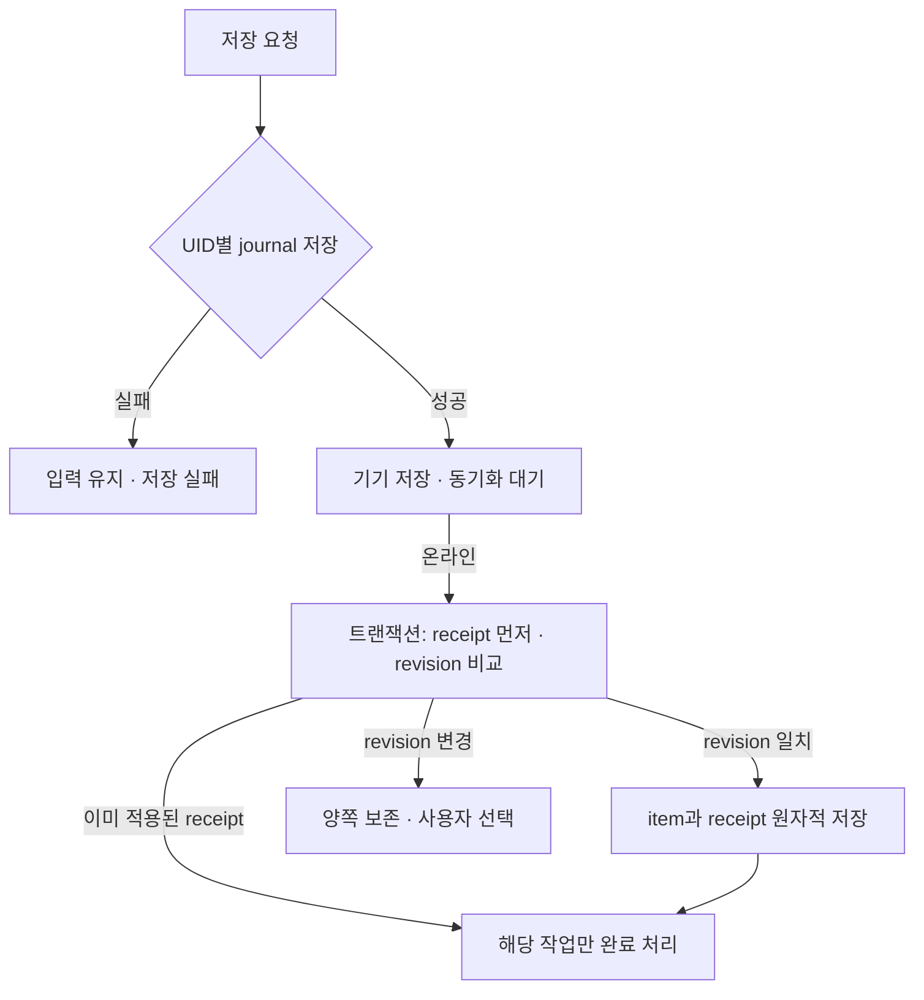

# Firebase 데이터와 오프라인 동기화 설계

작성 기준: 2026-10-03. 이 문서는 현재 결정된 v1 경계와 저장·동기화 계약을 정의한다. 사용자는 Next.js 16 정적 내보내기, Firebase Hosting Spark, Firebase Authentication(Google 로그인), Cloud Firestore를 선택했다. 베타에서 여러 계정을 허용하되 각 계정은 자기 데이터만 보는 개인 소유자 모델이다. PWA가 v1이며 네이티브 클라이언트와 푸시는 후속 단계다.

## 결정과 범위

- v1은 `output: 'export'`로 생성한 정적 파일을 Firebase Hosting에 배포하고, 브라우저 Firebase SDK가 Auth와 Firestore를 직접 호출한다. 모든 데이터 접근은 `src/lib/repository.ts`의 타입화된 계약을 통한다. UI에서 Firebase SDK를 직접 호출하거나 자체 HTTP API를 추가하지 않는다.
- v1은 사용자가 선택한 Firebase Spark 플랜을 전제로 한다. Next 서버 런타임/API, Firebase Admin SDK, Cloud Functions, Cloud Scheduler, 서버 작업자, 청구 계정 연결은 사용하지 않는다. 기간 시작 카운트다운은 화면에서 계산해 표시한다. 항목별 reminder rule과 notice 기록은 v1 데이터에 저장하지 않는다.
- Firestore의 기본 오프라인 쓰기 큐는 canonical 문서 저장에 사용하지 않는다. 동일 문서의 오프라인 쓰기가 기본적으로 마지막 쓰기 우선으로 적용될 수 있어 사용자가 고른 “충돌을 보존하고 선택” 정책을 보장하지 못한다.
- 오프라인 변경은 UID별 IndexedDB 초안/작업 로그에 먼저 저장한다. 온라인 상태에서만 Firestore 트랜잭션으로 반영하며, 기준 revision이 바뀌었으면 로컬안과 최신 서버안을 둘 다 보존하고 사용자가 고르게 한다. 필드가 겹치지 않더라도 자동 병합하지 않는다.
- v1 일정 입력은 수동 입력과 브라우저에서 한 번 가져오는 ICS 가져오기다. 외부 캘린더의 실시간 동기화는 범위 밖이다. 새 프로덕션 의존성을 선택해야 한다면 `[ASSUMPTION]`으로 PR에서 먼저 논의한다.

승인된 기준은 Next.js 16이다. 정적 내보내기는 서버 전용 기능을 제공하지 않는다. Firebase Hosting은 빌드 산출물을 호스팅하는 역할만 맡는다. 구성 근거는 [Next.js 정적 내보내기](https://nextjs.org/docs/app/guides/static-exports)다.

## 도메인 계약

저장 문서는 사용자가 입력한 의미와 동기화 메타데이터를 담는다. 날짜 전용 값은 UTC로 바꾸지 않는 YYYY-MM-DD 문자열이고, 정확한 시각은 UTC ISO instant와 IANA 시간대를 함께 보존한다. 홈의 하루 할 일/기간형/고정 일정은 기존 저장 kind 네 가지로 매핑한다.

    type ItemKind = 'event' | 'task' | 'deadline' | 'window';
    type Completion = 'pending' | 'completed';
    type UnscheduledTiming = { type: 'unscheduled' };
    type DateTiming = {
      type: 'date';
      startDate: string | null;
      endDate: string;
      timeZone: string;
    };
    type TimeTiming = {
      type: 'time';
      startAt: string | null;
      endAt: string | null;
      timeZone: string;
    };
    type ItemFields = {
      id: string;
      title: string;
      category?: string;
      notes?: string;
      sourceUrl?: string;
      importSource?: { uid: string; occurrenceKey: string; componentFingerprint: string };
      revision: number;
      updatedAt: string;
      deletedAt: string | null;
      lastMutationId: string;
      lastMutationDigest: string;
    };
    type PeriodChecklistItem = { id: string; title: string; completed: boolean };
    type ChecklistStatus =
      | { kind: 'none'; total: 0 }
      | { kind: 'incomplete'; remaining: number; total: number }
      | { kind: 'complete'; remaining: 0; total: number };
    type StartCountdownDisplay = { enabled: boolean; daysBefore: number }; // 0..30, default 1
    type PeriodFields = {
      checklist: PeriodChecklistItem[];
      startCountdown: StartCountdownDisplay | null;
    };
    type EventItem = ItemFields & {
      kind: 'event';
      completion?: never;
      checklist?: never;
      startCountdown?: never;
      timing: (DateTiming & { startDate: string; endDate: string }) |
        (TimeTiming & { startAt: string; endAt: string });
    };
    type TaskItem = ItemFields & {
      kind: 'task';
      checklist?: never;
      startCountdown?: never;
      timing: UnscheduledTiming | (DateTiming & { startDate: null; endDate: string }) | (TimeTiming & { startAt: null; endAt: string });
      completion: Completion;
    };
    type DeadlineItem = ItemFields & PeriodFields & {
      kind: 'deadline';
      timing: (DateTiming & { endDate: string }) | (TimeTiming & { endAt: string });
      completion: Completion;
    };
    type WindowItem = ItemFields & PeriodFields & {
      kind: 'window';
      timing: (DateTiming & { startDate: string }) |
        (TimeTiming & { startAt: string });
      completion: Completion;
      startCountdown: StartCountdownDisplay;
    };
    type CalendarItem = EventItem | TaskItem | DeadlineItem | WindowItem;
    type WithoutServerMetadata<T> = T extends ItemFields
      ? Omit<T, 'revision' | 'updatedAt' | 'deletedAt' | 'lastMutationId' | 'lastMutationDigest'>
      : never;
    type ProposedCalendarItem = WithoutServerMetadata<CalendarItem>;
    type MutationKind = 'upsert' | 'delete';
    function deriveChecklistStatus(items: readonly PeriodChecklistItem[]): ChecklistStatus;

deadline/window의 checklist는 부모 문서 안의 배열이며 빈 배열을 기본값으로 둔다. 하위 항목은 고유 ID, 제목, 체크 여부만 가진다. checklist 요약 상태는 저장하지 않고 현재 배열에서 파생한다. 항목이 0개면 none, 일부가 남으면 incomplete(remaining/total), 전부 완료면 complete다. 표시 문구는 1개일 때 미완료/완료, 2개 이상일 때 미완료(n/m)이며 n은 남은 수, m은 전체 수다. 모두 끝났을 때는 완료라고 표시한다. 새 하위 항목을 추가하면 파생 상태는 자동으로 incomplete가 된다.

사용자는 단일 Firestore 문서 저장을 선택했고, 하위 할 일 최대치는 4개로 정했다. Rules가 허용하지 않는 5~20번째 슬롯까지 매번 검사하던 비용을 제거한 뒤, 최대 길이 부모 필드와 제목 200자인 하위 항목 4개를 포함한 create/update/tombstone 쓰기가 Emulator에서 통과하고 5개 쓰기는 거부됨을 확인했다. 제목은 각 200자, 초과 입력은 저장하지 않고 UI draft를 보존한다. revision·journal CAS/successor 계약은 [핵심 구현 설계](implementation/04-core-implementation.md)를 함께 검토한다.

기간형 부모의 completion은 실제 제출/신청 여부이고 checklist 상태와 별개다. 화면은 두 값을 각각 라벨링한다. window는 시작이 필수라 startCountdown 설정을 갖는다. deadline은 시작이 있을 때 표시 설정을 갖고, 시작이 없으면 null이다. 새 기간 항목에서 설정 기본값은 enabled=true, daysBefore=1이며 daysBefore는 정수 0~30이다. 0은 시작 시각부터 표시한다. task와 event에는 checklist/startCountdown을 저장하지 않는다.

모든 저장 항목에는 ID/kind/title/timing/revision/updatedAt/deletedAt/mutation 메타데이터를 둔다. importSource는 ICS로 가져온 경우에만 유지한다. event에는 completion이 없으며 task/deadline/window에는 필수다. deadline은 마감 end 값 필수, window는 start 값 필수, time 형식 event는 start/end 모두 필수다. endAt이 null인 window는 종료 미정이라 시간 바를 표시하지 않는다. 날짜형 endDate는 포함되는 마지막 날짜다. 날짜 전용 값은 그대로 저장하고 instant는 Firestore Timestamp와 UTC ISO 문자열 사이에서 adapter가 변환한다. opensAt/dueAt/closesAt은 화면 라벨일 뿐 별도 저장 필드가 아니다. 수동 검증은 checklist 각 항목의 비어 있지 않은 title, id 유일성, completed boolean과 startCountdown의 enabled boolean/0~30 정수 범위를 확인한다. 기간 부모에만 checklist를 허용하고, 설정이 enabled인데 시작 시각/날짜가 없으면 거부한다. 타입 변경으로 자식 checklist가 소실되지 않게 기간형에서 task/event로 바꾸려는 저장은 자식이 남아 있으면 거부하고 사용자에게 명시적 정리 후 다시 시도하게 한다.

경과/잔여 진행과 시간 단계는 timing, completion, 현재 시각으로부터 계산하고 별도 필드로 저장하지 않는다. 기간 바는 시작·종료가 모두 알려진 경우에만 시간 경과로 계산한다. 종료 미정 window에는 경과 바를 표시하지 않는다. Figma의 시작 전 중립 레일·시작점은 별도의 시작 표시이며 경과율이나 progressbar 접근성 값을 갖지 않고 시작 후에는 숨긴다. D-Day, 카운트다운, checklist 완료 상태는 서버에 계산값으로 저장하지 않는다.

도메인 API의 시간형 instant는 UTC ISO 문자열로 정규화한다. Firestore adapter는 이를 Timestamp로 encode/decode한다. 날짜 전용 값은 문자열 그대로 보존한다. `startCountdown`은 기간 시작을 화면에서 알려주는 표시 설정이며, 별도 알림 규칙·예약 작업·인앱 notice를 만들지 않는다.

같은 UID의 Firestore 경로는 다음과 같다. 계정 간 공유 컬렉션은 없다.

    users/{uid}/calendarItems/{itemId}
    users/{uid}/mutationReceipts/{operationId}

revision은 생성 시 1이며 canonical 부모 문서가 바뀔 때만 1씩 증가한다. 하위 항목 추가/체크/편집/삭제도 부모 문서의 변경이다. 삭제는 checklist와 함께 현재 내용을 보존하는 tombstone으로 처리한다. tombstone은 같은 ID로 되살릴 수 없다. checklist 충돌에서 서버/로컬 배열을 자동 병합하지 않으며 두 판본을 함께 보여준다. Spark v1에는 정리 작업자가 없으므로 tombstone과 영수증은 자동 만료하지 않는다.

## Repository 경계

`src/lib/repository.ts`는 UI가 의존하는 유일한 영속성 경계다. Firebase Auth/Firestore SDK 타입과 `Timestamp`, `DocumentSnapshot`, `Unsubscribe`는 adapter 안에 가둔다. UI에는 plain TypeScript 도메인 타입과 명시적 결과만 노출한다. 프로젝트 지침의 `ErrorResponse`는 향후 HTTP 경계를 만들 때 적용하되, v1에서 존재하지 않는 HTTP API를 가정하지 않는다.

```ts
type QueryRange = { from: string; to: string; timeZone: string };
type SaveResult =
  | { status: 'saved'; item: CalendarItem; operationId: string; committedRevision: number }
  | { status: 'conflict'; mutation: PendingDraft; remote: CalendarItem }
  | { status: 'queued'; mutation: PendingDraft };
type DraftInput = {
  itemId: string;
  expectedLocalSequence: number | null;
  baseRevision: number | null;
  baseSnapshot: ProposedCalendarItem | null;
  mutationKind: MutationKind;
  proposedSnapshot: ProposedCalendarItem;
};
type ConflictChoice =
  | { choice: 'keep-remote' }
  | { choice: 'use-local' }
  | { choice: 'edit'; edited: ProposedCalendarItem };
type ImportIssue = { code: string; message: string; occurrenceKey?: string };
type ImportCandidate = {
  key: string;
  uid: string;
  occurrenceKey: string;
  componentFingerprint: string;
  title: string | null;
  timing: EventItem['timing'] | null;
  disposition: 'new' | 'duplicate' | 'changed-source';
  existingItemId?: string;
  existingRevision?: number;
  issue?: ImportIssue;
};
type ImportPreview = {
  previewId: string;
  fileName: string;
  period: { fromDate: string; toDate: string };
  candidates: ImportCandidate[];
  issues: ImportIssue[];
};
type ImportResult = {
  created: number;
  skipped: number;
  replaced: number;
  addedAsNew: number;
  issues: ImportIssue[];
};
type ImportDecision = {
  candidateKey: string;
  action: 'create' | 'skip' | 'replace' | 'add-as-new';
};
type SyncState = {
  connection: 'online' | 'offline' | 'unknown';
  localJournal: 'available' | 'unavailable';
  firestoreCache: 'available' | 'unavailable' | 'empty-offline';
  pendingCount: number;
  conflictCount: number;
};
type ItemView = {
  display: ProposedCalendarItem;
  canonical: CalendarItem | null;
  localDraft: PendingDraft | null;
  syncState: 'synced' | 'offline-draft' | 'syncing' | 'conflict' | 'offline-read-only';
  conflictRemote?: CalendarItem;
};
type BackupExport = {
  formatVersion: 1;
  ownerUid: string;
  exportedAt: string;
  canonicalSource: 'server' | 'cache';
  canonicalItems: CalendarItem[];
  pendingLocalChanges: PendingDraft[];
};

interface Repository {
  listItems(range: QueryRange): Promise<ItemView[]>;
  subscribeItems(range: QueryRange, onItems: (items: ItemView[]) => void): () => void;
  readItem(id: string): Promise<ItemView | null>;
  saveDraft(input: DraftInput): Promise<SaveResult>;
  resolveConflict(itemId: string, choice: ConflictChoice): Promise<SaveResult>;
  importIcs(file: File): Promise<ImportPreview>;
  commitIcsImport(previewId: string, decisions: ImportDecision[]): Promise<ImportResult>;
  exportBackup(): Promise<BackupExport>;
  flushPending(): Promise<void>;
  subscribeSyncState(onState: (state: SyncState) => void): () => void;
}
```

기간 checklist의 추가·체크·편집·삭제는 별도 repository API를 만들지 않고 변경된 부모 ProposedCalendarItem 전체를 saveDraft로 보낸다. checklist status는 projection에서 deriveChecklistStatus로 계산하며 canonical 문서에는 저장하지 않는다. 홈의 상단 3개 기간과 초과 팝오버, `/calendar?filter=period` 전체 목록도 같은 `ItemView` projection에서 정렬·필터링한다. 순위/요약 전용 Firestore 문서, 영속 순위 필드, 화면별 listener를 새로 만들지 않는다. 위 코드는 계약의 스케치다. `ProposedCalendarItem`은 revision/server timestamp/tombstone을 클라이언트가 위조하지 않게 제외한 타입이다. `ItemView`는 서버 canonical 문서와 UID별 로컬 초안을 겹쳐 만든 화면용 projection이다. 신규 오프라인 item은 `canonical: null`, `baseRevision: null`, proposal은 채우며 가짜 `revision: 0` 문서를 만들지 않는다. 기존 항목 충돌에서는 local proposal을 표시 데이터로 유지하고 `canonical`과 `conflictRemote`도 함께 노출해 두 안을 잃지 않는다. create는 클라이언트에서 item ID를 먼저 만든다. delete도 item ID, base revision/snapshot, `delete` mutation을 초안 로그에 넣는다. revision을 가진 원격 item이 사라진 경우 conflict로 가장하지 않고 무결성 오류를 반환한다. Repository input은 무효한 조합이 만들어지지 않도록 discriminated union으로 유지하고 validator에서 교차 필드 규칙을 검사한다. v1은 사용 규모가 작다는 제품 가정으로 각 UID의 전체 개인 `calendarItems` collection을 한 번 구독하고 tombstone/range filter/sort를 client memory에서 수행한다. 다른 사용자의 경로를 쿼리하지 않으며, 전체 구독 크기나 읽기 비용이 커지면 기간 query/pagination으로 변경한다. Firebase SDK 및 IndexedDB 접근은 `repository.ts` 내부 adapter만 허용하며 컴포넌트가 직접 영속 저장소를 만지지 않는다. `importSource.uid`와 `occurrenceKey`는 생성 이후 불변이고, `componentFingerprint`는 사용자가 변경된 ICS를 명시적으로 적용할 때 같은 revision 트랜잭션으로 갱신한다. 기본 화면의 Auth 상태 복원/Google 리다이렉트 처리 또한 인증 adapter에 둔다.

초기 조사 때 `AGENTS.md`에는 Prisma migrate 안내가 남아 있었다. 구현을 시작하며 저장소 결정을 반영해 Node 24/pnpm 11, Firebase Emulator와 JDK 21 기준 셋업으로 정리했다. Firebase 선택을 Prisma/SQL로 되돌리지 않는다. 정확한 실행 명령은 프로젝트 `AGENTS.md`와 실제 manifest를 따른다.

## 오프라인 초안과 충돌 보존 프로토콜



아직 한 번도 송신하지 않은 신규 항목을 삭제하면 journal의 신규 생성과 후속 초안을 원자적으로 취소한다. 존재하지 않는 서버 문서에 delete를 송신하지 않는다. 생성이 이미 `sending`이면 receipt로 결과를 확인한 뒤 생성이 반영된 revision에 delete를 적용한다. 기존 항목 삭제는 revision 확인 후 서버 snapshot의 본문을 그대로 보존하고 tombstone만 설정한다.

IndexedDB에는 UID 네임스페이스로 구분한 로컬 초안/작업 로그를 둔다. primary key는 `[uid, operationId]`, secondary index는 `[uid, itemId, localSequence]`로 하여 전송 중인 작업과 successor가 같은 항목에 함께 남도록 한다. 항목별 active pointer는 `[uid, itemId]`를 가리키되 응답 처리에서 비교 후 갱신한다. 레코드는 최소 다음 정보를 담는다.

```ts
type DraftStage = 'queued' | 'sending' | 'conflicted';
type PendingDraft = {
  uid: string;
  itemId: string;
  localSequence: number;
  operationId: string;
  predecessorOperationId: string | null;
  baseRevision: number | null;
  baseSnapshot: ProposedCalendarItem | null;
  proposedSnapshot: ProposedCalendarItem;
  mutationKind: MutationKind;
  stage: DraftStage;
  remoteSnapshot?: CalendarItem;
  payloadDigest: string;
  createdAt: string;
  updatedAt: string;
};
```

초안은 UI의 낙관적 표시보다 먼저 IndexedDB 트랜잭션에 저장한다. 저장 완료 전에는 “저장 중” 상태를 보여주고 저장 실패 시 변경을 잃지 않도록 편집 화면을 유지한다. 새 문서는 클라이언트가 먼저 만든 ID와 `baseRevision: null`, `mutationKind: 'upsert'`로 저장한다. 삭제 intent는 기존 snapshot을 제안 snapshot으로 함께 보존하고 `mutationKind: 'delete'`를 기록한다. 앱 시작 시 UID별 로그를 복구하고, 인증 UID가 다르면 다른 UID의 로컬 초안을 노출하거나 업로드하지 않는다. 로그/캐시에는 사용자 입력이 포함될 수 있으므로 로그아웃 후 다른 계정으로 전환 시 UID별 화면 상태를 분리한다. 같은 브라우저를 다른 사람이 쓰는 경우 로컬 저장 데이터가 암호화된다고 약속하지 않는다.

Firestore Web의 persistent cache는 기본 활성 상태가 아니므로 v1은 이를 명시적으로 켜서 이전에 읽은 일정의 오프라인 조회를 지원한다. 이 캐시는 브라우저에 남고 암호화된 저장소가 아니다. 모든 앱 조회 경로는 인증 UID에서 만든 경로만 사용하고, 로그아웃 즉시 이전 계정의 화면/로컬 초안을 숨긴다. 캐시된 문서는 오프라인 권한 확인의 대체물이 아니며, 타 UID 경로의 캐시를 읽거나 렌더링하지 않는다. 공유 기기에서 계정을 전환하는 경우 로컬 캐시/초안이 기기 사용자에게 보일 수 있음을 UX에 알린다. 단순히 `navigator.onLine`만으로 서버 도달 여부를 확정하지 않는다.

온라인 동기화는 포그라운드에서 항목별 직렬 처리한다.

1. `queued` 초안의 불변 payload를 만들고 `sending`으로 IndexedDB에 기록한다. operation ID는 `crypto.randomUUID()` 등 플랫폼 API로 생성한다. digest는 키 순서를 정규화한 JSON의 mutation kind, item ID, base revision, proposed snapshot에서 Web Crypto SHA-256으로 계산하고 64자 lowercase hex로 저장한다. operation ID는 특정 불변 payload에 결속한다. 전송 전 초안을 사용자가 다시 수정하면 이전 미전송 작업을 새 payload/새 ID로 대체할 수 있지만, `sending` 이후 payload와 ID는 절대 바꾸지 않는다.
2. 인터넷이 실제 사용 가능할 때 Firestore transaction을 실행한다. 먼저 `mutationReceipts/{operationId}`와 대상 item을 읽는다(모든 읽기는 transaction 쓰기보다 먼저). 동일 ID 영수증이 이미 있고 digest가 같으면 작업은 이미 성공한 것이다. 영수증 digest가 다르면 ID 재사용 오류로 중단한다.
3. 영수증이 없으면 서버 item의 `revision`이 초안의 `baseRevision`과 같은지 비교한다. 신규 항목은 해당 ID가 없는 것이 base 조건이다. 일치할 때만 upsert snapshot을 저장하거나 `mutationKind: 'delete'`면 해당 문서에 tombstone을 설정하고, revision을 1 증가시켜 `updatedAt = serverTimestamp()`, `lastMutationId`, `lastMutationDigest`와 함께 기록한다. `mutationReceipts/{operationId}`에도 같은 payload digest와 result revision, server `createdAt`을 기록한다. 두 문서는 한 transaction으로 함께 생성/변경한다.
4. revision이 다르면 서버의 최신 문서(삭제 tombstone 포함)와 제안 snapshot/삭제 intent를 함께 로컬에 보존하고 `conflicted`로 바꾼다. UI는 서버안 유지, 로컬안으로 다시 적용, 두 안을 보며 수동 편집 중 하나를 명시적으로 선택하게 한다. 선택 없이 수정/삭제하지 않는다. 로컬안 적용은 최신 서버 revision을 새 base로 삼아 새 operation ID로 재시도한다. 원격이 삭제 tombstone이면 로컬안 복구는 원본 ID를 되살리는 대신 사용자가 확인한 뒤 새 ID로 복제해 원본 tombstone을 보존한다. 원래 충돌 초안은 사용자가 선택을 마칠 때까지 기록으로 남긴다.
5. `sending` 후 응답이 끊겨 성공 여부를 모르면 로그를 지우지 않는다. 앱 재개 때 같은 ID와 같은 digest로 재시도해 영수증을 조회한다. 먼저 커밋된 다음 다른 기기에서 더 새 revision이 저장되었더라도 기존 영수증이 확인되면 그 operation은 성공으로 인정한다. 이때 조회한 더 새 item은 remote 상태로 표시하지만 successor base를 무조건 전진시키지 않는다.

영수증은 충돌 검사보다 먼저 확인해야 한다. transaction 성공 후 클라이언트 응답만 유실된 상황에서 새 revision이 만들어졌을 수 있기 때문이다. `lastMutationId`는 Rules에서 item과 영수증의 원자적 변경 관계를 검사하는 보조값일 뿐, 과거 작업 재시도에 대한 영구 멱등성 표식으로 쓰지 않는다. 영구 영수증이 그 역할을 맡는다. 영수증에는 작업 재생에 필요한 식별자/결과 메타데이터만 보관하고 사용자 노트 등 전체 payload를 중복 보관하지 않는다.

편집 중인 항목의 전송 payload는 전송 시작 시 고정한다. 전송 도중 같은 항목을 다시 편집하면 기존 `sending` 작업을 덮지 말고 더 큰 `localSequence`와 새 operation ID를 가진 successor 초안으로 별도 저장한다. 앞 작업이 성공하면 그 operation의 정확한 `resultRevision`과 제안 snapshot만 successor의 base가 된다. 성공 후 다른 기기가 revision을 더 올렸다면 successor는 이전 resultRevision을 유지하고 다음 transaction에서 revision conflict가 발생해야 한다. 최신 원격 revision으로 base를 무조건 전진시키면 원격 변경을 조용히 덮을 수 있다. 앞 작업이 충돌하면 successor도 자동 flush하지 않고 충돌 화면에서 순서대로 해결한다. ACK 처리에서는 `operationId`가 일치하는 journal row만 완료 처리하고 active pointer가 해당 ID를 아직 가리킬 때만 이동한다. 늦은 ACK가 더 새 successor row/pointer를 지우지 않도록 반드시 compare-and-set한다. 항목별 직렬 큐는 복잡한 병합 엔진이나 분산 잠금이 아니다.

Firestore transaction은 오프라인에서 실패하고 재시도될 수 있으므로 callback 안에 UI 변경, ID 생성, IndexedDB 삭제, 외부 부작용을 넣지 않는다. transaction 도중 서버 문서가 바뀌면 SDK가 callback을 다시 실행할 수 있다. 결과 전달 후 IndexedDB의 `queued/sending/conflicted` 상태를 처리하며, 이미 적용된 draft 완료/archival은 같은 operation ID 영수증 확인 뒤 그 row에만 적용한다. 문서의 모든 변경을 revision 체크로 막으므로 수정 시점이 겹치지 않아도 stale base는 충돌로 보인다. 이는 사용자가 요청한 보존 정책의 의도적인 비용이다.

## 인증, 보안 규칙, 데이터 격리

실제 Hosting 주소가 `web.app` 또는 사용자 도메인이면 Firebase config의 `authDomain`을 앱을 제공하는 같은 도메인으로 설정한다. Google OAuth 허용 redirect URI에는 `https://<같은 도메인>/__/auth/handler`를 등록하고 Auth 승인 도메인도 맞춘다. `/__/auth/*`는 Hosting 예약 경로로 유지하며 서비스 워커와 앱 rewrite에서 가로채지 않는다. 이는 Safari 등의 제3자 저장소 차단에 대응하는 [Firebase redirect 로그인 공식 권장안](https://firebase.google.com/docs/auth/web/redirect-best-practices)의 Option 1이다(2026-10-03 확인). 로그인 복귀와 설치된 iOS PWA의 세션 복원은 실기기에서 확인한다.

Google 로그인은 [Firebase Authentication 웹 Google 로그인](https://firebase.google.com/docs/auth/web/google-signin)의 redirect flow를 사용한다. 배포 도메인은 Firebase Auth의 승인 도메인에 등록하고 Safari에서 redirect 복귀 후 사용자 상태를 복구하는 흐름을 테스트한다. 정적 산출물에 포함되는 Firebase web config는 공개 식별자이지 Admin 자격 증명이 아니다. 서비스 계정 키, Admin credentials, 비밀값은 클라이언트 bundle이나 저장소에 넣지 않는다. 테스트/프로덕션 프로젝트를 분리한다.

Firestore Rules는 기본 거부로 시작한다. `request.auth != null` 및 경로 UID와 `request.auth.uid` 동일성을 모든 사용자 컬렉션에 강제한다. 클라이언트 SDK는 보안 규칙의 검사를 받는다. 기본 최소 규칙은 다음을 검증한다.

- item 허용 키 집합은 id, kind, title, category, notes, sourceUrl, importSource, timing, completion, checklist, startCountdown, revision, updatedAt, deletedAt, lastMutationId, lastMutationDigest다. required 키는 id/kind/title/timing/revision/updatedAt/deletedAt/lastMutationId/lastMutationDigest이며 deadline/window에는 checklist와 startCountdown도 요구한다. 두 추가 필드는 deadline/window에만 허용하고 event/task에는 금지한다. deadline은 시작이 없으면 startCountdown null, 시작이 있으면 설정 객체를 요구한다. checklist는 deadline/window 한 항목당 최대4개이며 각 원소는 정확히 id/title/completed만 허용하고 ID 유일성, 비어 있지 않은 title, boolean completed를 validator/Rules 양쪽에서 검사한다. reminder field는 v1에서 허용하지 않는다. 기존 title 200자, notes 10,000자, category 64자, source URL 2,048자 제품 기본값을 유지한다. URL은 http/https만 허용하며 링크를 새 창에 열 때 opener 접근을 차단한다.
- create는 owner 경로 UID와 데이터 `id`/경로 itemId 일치, 허용 키만, title nonempty string, `revision == 1`, `deletedAt == null`, `updatedAt == request.time`을 요구한다. `kind`/timing/completion 교차 규칙은 아래 매트릭스를 적용한다. `id`와 source identity는 update 시 바꾸지 못한다. 종류를 바꾸는 편집은 새 kind의 전체 필드·timing·completion 검증을 통과해야 하며 event로 전환하면 completion 필드를 제거한다.
- Rules가 검사할 timing 교차 규칙: `unscheduled`는 task만 가능; date의 `startDate`는 null 또는 regex `^\d{4}-\d{2}-\d{2}$`, `endDate`는 같은 형식의 필수 string이다; task의 startDate는 null, deadline은 선택, event/window는 startDate 필수이며 ISO 날짜 사전순 `startDate <= endDate`를 검사한다; event/window는 start 필수; time wire 값은 `startAt`/`endAt`가 Timestamp 또는 허용된 null이고, event에는 둘 다 필수, task/deadline에는 end 필수이며 task의 start는 null이어야 해 하루를 가로지르는 범위형 task를 허용하지 않는다; window에는 start 필수, 두 값이 있을 때 `endAt > startAt`. Date/Time 중첩 키는 각 `type`에 맞는 정해진 집합만 허용한다. Rules는 date 모양/범위순서와 Timestamp 순서를 검사하고, 실제 Gregorian 달력 유효성 검사는 client validator가 하고 테스트한다. `timeZone`은 문자열 형식/길이를 Rules에서 제한하고 IANA 이름 존재 여부는 client `Intl.DateTimeFormat` validator + 테스트가 확인한다.
- completion은 `task/deadline/window`에서 `pending|completed` 필수이며 event에는 허용하지 않는다. deadline/window의 completion은 제출/신청 자체 결과이고 checklist 상태와 독립적이다. startCountdown.daysBefore는 정수 0~30, enabled는 boolean이며 활성인데 timing start가 없으면 거부한다. 하위 항목을 수정해도 부모 completion을 자동으로 바꾸지 않는다. task는 하루 할 일이므로 date의 startDate와 time의 startAt은 null이어야 한다; 여러 날짜에 걸친 업무는 checklist를 가진 deadline/window로 저장한다.
- update는 기존 소유 문서가 tombstone이 아닐 때만 허용하며 키/불변 필드 제한을 지키고 `revision == resource.data.revision + 1`, `updatedAt == request.time`이어야 한다. 일반 upsert는 `deletedAt == null`을 유지한다. 삭제 변경은 그 외 content를 동일하게 유지한 채 `deletedAt == request.time`만 설정한다. tombstone 이후 update와 물리 delete는 거부한다.
- `mutationReceipts`는 허용 키 `itemId`, `payloadDigest`, `resultRevision`, `createdAt`만 갖고 create-only로 한다. `createdAt == request.time`과 양수 정수 resultRevision을 요구한다. path operationId와 item `lastMutationId`를 연결하고 digest는 64자 lowercase hex string인지 검사한다. digest는 클라이언트가 불변 payload에서 계산하며 Rules가 SHA-256을 계산/진위인증한다고 가정하지 않는다.
- 원자성은 양방향으로 확인한다. item create/update Rule은 receipt가 이전에는 없고 transaction 후 존재하며 receipt의 itemId/resultRevision/payloadDigest가 item after-image의 ID/revision/`lastMutationId`/`lastMutationDigest`와 맞는지 `existsAfter/getAfter`로 검사한다. receipt create Rule은 이전 receipt 부재, after-image item 존재, item의 `lastMutationId`와 `lastMutationDigest`가 receipt operationId/digest와 일치, `resultRevision` 일치, 신규 item이면 revision 1 또는 기존 active item이면 이전 revision+1인지 확인한다. 이 digest 연결은 동일 payload 표시를 양쪽 문서에 고정할 뿐 Rules가 SHA-256을 검증한다는 뜻이 아니다. receipt update/delete와 item/receipt 단독 변경은 거부한다. Rules 호출 한도와 `existsAfter/getAfter()` 문법은 Emulator에서 검증한다. 공식 API: [Firestore Rules namespace](https://firebase.google.com/docs/reference/rules/rules.firestore).
- 잘못된 기간 쿼리, 타 UID 경로 접근, 영수증 재작성은 거부되어야 한다. Admin SDK는 Rules를 우회하므로 v1에 포함되지 않는다.

Firebase의 공식 문서는 client SDK 요청에 Rules가 적용되고, Admin SDK는 Rules를 우회함을 명시한다. 소유자 분리는 [Firestore Rules 조건](https://firebase.google.com/docs/firestore/security/rules-conditions)을 따른다. Test mode는 공개 접근 규칙을 만들 수 있으므로 프로덕션에 두지 않는다.

`getAfter`와 `existsAfter`의 동작은 [Firestore Rules 공식 API](https://firebase.google.com/docs/reference/rules/rules.firestore)를 따른다(2026-10-03 확인). 위 보안 설계는 실행한 Rules가 아니라 구현할 검증 계약이며 Emulator의 양방향 원자성·불법 쓰기 테스트가 통과해야 한다.

## Firebase 초기화, 배포, 오프라인 읽기

Next.js 구성은 서버 데이터 API를 노출하지 않는 정적 export로 한다. Firebase 초기화 모듈은 브라우저에서만 실행되도록 client boundary에 둔다. `src/lib/repository.ts`와 Auth adapter가 필요한 코드에서 `use client`를 선언한다. 빌드 시 Firebase 자격 정보를 요구하는 서버 코드를 만들지 않는다. Firebase Hosting은 `out/` 정적 산출물과 실제 export된 경로를 제공하고 HTTPS를 사용한다. OAuth redirect에 사용할 실제 Hosting 도메인을 Auth 콘솔과 일치시킨다.

App Router는 실제 정적 산출되는 고정 경로(`/`, `/calendar`, `/tasks`, `/settings`)를 사용한다. 개별 item 화면은 `/calendar?item=...`처럼 이미 export된 경로의 query로 식별하고, 로그인 후 client가 UID-scoped 자료를 읽는다. `generateStaticParams` 없는 사용자별 동적 경로를 전제로 하지 않으며, 모든 미지 경로를 `/index.html`로 돌리는 일반 SPA fallback으로 App Router 정적 라우팅을 우회하지 않는다. service worker는 빌드 버전이 붙은 앱 shell의 HTML/JS/CSS/icon만 cache하고 Firebase authenticated response나 Firestore payload를 별도 cache하지 않는다. 새 버전 activate 시 이전 shell cache를 정리한다.

Firestore listener는 화면의 현재 기간 자료를 갱신하고, metadata listener로 pending writes 여부를 표시할 수 있다. 본 설계에서는 canonical offline writes를 만들지 않으므로 pending write 표식은 Firestore 동기화 자체의 최종 일관성 확인과 로컬 초안 queue 상태를 혼동하지 않도록 adapter가 정규화한다. UI 상태는 최소 `synced`, `offline-draft`, `syncing`, `conflict`, `auth-required`, `error`로 구분한다.

Firestore Web 오프라인 문서는 web persistent cache가 기본 꺼져 있고 브라우저 로컬 캐시가 자동 삭제되지 않을 수 있으며, 동일 문서의 여러 변경은 마지막 쓰기 우선이라고 설명한다. transaction 문서는 transaction이 오프라인에서 실패하고 변경된 문서에 대해 재시도한다고 설명한다. SDK listener로 서버 변화를 구독하되 canonical 작업은 IndexedDB journal + 온라인 transaction으로 분리한다. 참고: [Firestore 오프라인 데이터](https://firebase.google.com/docs/firestore/manage-data/enable-offline), [Firestore transaction](https://firebase.google.com/docs/firestore/manage-data/transactions).

Firestore persistent cache 초기화가 실패한 환경에서도 온라인 Auth/Firestore 읽기는 계속 가능하게 둔다. 실패한 capability를 `SyncState`에 표시하고, persistent cache가 없으면 이전에 읽지 않은 데이터는 오프라인에서 보이지 않는다. 첫 로그인/첫 collection load가 오프라인이면 Firestore가 빈 cache query를 반환할 수 있으므로 “데이터 없음”으로 처리하지 말고 `empty-offline` 상태와 재연결 안내를 보여준다. repository는 `navigator.onLine`만 믿지 않고 server snapshot metadata/요청 결과로 연결 여부를 확인한다. IndexedDB journal 저장이 실패하면 online/offline 모두 canonical 서버 transaction으로 우회 저장하지 않는다. 저장 실패를 명시하고 폼 입력을 유지해 기기 저장소 복구 후 다시 시도하게 한다. 이 환경의 읽기는 online-only/read-only이며, local journal 없이 응답 상실이나 재실행에서 편집을 보존할 수 있다고 약속하지 않는다.

로그아웃/UID 전환 전에는 미동기화 초안마다 사용자가 다음 중 선택하게 한다: (1) 온라인이면 flush하고 모든 충돌을 해결한 뒤 로그아웃, (2) canonical/pending 구역이 분리된 JSON 백업을 내려받고 초안은 UID별 로컬 보관, (3) 같은 UID로 돌아올 때까지 UID별로 초안을 남기고 로그아웃, (4) 명시적으로 확인한 뒤 로컬 초안을 폐기. 다른 UID로 로그인해도 이전 UID의 초안은 숨겨 두며 자동 업로드하지 않는다. 앱 자체 IndexedDB journal은 Firestore SDK persistence와 별도 DB이므로 Firestore cache를 지워도 journal은 보존/삭제 선택에 따른다.

공유 기기에서 사용자가 “Firestore 캐시 삭제”를 선택하면 먼저 위 초안 선택을 끝내고 다른 탭/Firestore client가 사용 중이 아닌지 확인한다. 그 뒤 Firebase JS API가 요구하는 순서인 `terminate(firestore)` → `clearIndexedDbPersistence(firestore)`를 사용한다. 정리 후 새 Firestore instance를 초기화한다. clear는 캐시 문서와 SDK pending writes를 지우지만 안전한 secure erase가 아니며, 다른 탭이 살아 있거나 인스턴스가 active면 실패할 수 있다. v1은 Firestore offline write queue를 사용하지 않지만, journal의 `sending` 작업은 cache clear 전에 서버 영수증으로 확정하거나 같은 operation ID로 재시도하도록 보존한다. 이 동작과 API 제한은 [Firebase JS Firestore API](https://firebase.google.com/docs/reference/js/firestore)의 `terminate`/`clearIndexedDbPersistence` 항목을 따른다.

UID가 바뀌면 이전 listener·타이머·송신 조율을 해제하고 UI 상태를 즉시 비운다. 늦게 도착한 이전 UID의 응답은 해당 UID journal만 처리하며 현재 계정 화면에 반영하지 않는다.

## ICS 가져오기와 시간대

파일을 브라우저에서 파싱하고 저장 전 preview를 보여준다. 가져오기에서 지원하는 `VEVENT` 필드, recurrence 부분집합, 기간·파일·occurrence 한도, unsupported component 대응은 [제품 사양 7절](02-product-spec.md#7-ics-가져오기-범위)을 단일 기준으로 삼는다. 반복 예외가 지원되지 않는 시리즈는 기본 occurrence만 임의로 저장하지 않고 시리즈 전체를 preview error로 만든다. ICS `SUMMARY`가 없어 도메인의 필수 title을 만들 수 없으면 사용자에게 제목 입력을 요청한다. ICS의 zero-duration VEVENT가 앱의 양의 길이 event 조건에 맞지 않으면 해당 건에 오류를 설명하고 기간을 임의로 덧붙이지 않는다.

중복 identity는 원본 `UID`와 occurrence key의 쌍이다. 단일 일정은 `single`; RRULE occurrence key는 원래 DTSTART의 표현을 보존한다. 날짜형은 `DATE:YYYY-MM-DD`, UTC는 `UTC:<ISO instant>`, TZID는 `TZID=<IANA>:<원래 wall time>`, floating은 사용자가 확인한 시간대를 붙인 `FLOAT=<IANA>:<원래 wall time>`이다. TZID의 wall time을 변환한 UTC instant는 timing에 저장하고 identity로 쓰지 않아 시간대 규칙 데이터 갱신이 같은 발생을 새 항목으로 만들지 않게 한다. `RECURRENCE-ID` 예외는 제품 사양의 unsupported 규칙을 따른다. UID가 없는 component는 preview error로 표시하고 title/hash 기반 identity를 추측하지 않는다. UTF-8 JSON 배열 `[UID, occurrenceKey]`의 SHA-256으로 `ics_<64자 hex>` primary item ID를 결정하고 `importSource`에 원본 UID, occurrence key, 가져온 component fingerprint를 저장한다. 재가져오기 시 같은 primary identity/fingerprint는 중복 건너뛴다. 같은 identity인데 원본 fingerprint가 바뀌었으면 preview에 차이를 보여주고, 사용자가 기존 값 유지/ICS 값으로 교체/별도 항목으로 추가 중 선택해야 한다. 기존 사용자의 수정 내용을 자동 덮어쓰지 않는다.

`add-as-new` 복사본은 새 UUID와 같은 importSource를 보존하되 primary ID로 취급하지 않는다. 다음 preview는 deterministic primary 항목을 비교 대상으로 삼고, 관련 복사본은 링크로 함께 보여준다. primary가 tombstone이면 `deleted-source` 상태로 표시하여 기본 skip하고, 명시적 별도 추가만 새 ID로 허용한다. primary가 없고 복사본만 있을 때도 관련 복사본을 알리고 자동 추가하지 않는다. 사용자가 선택한 clone ID는 imports journal에 먼저 기록하여 부분 성공 재시도에서 다시 생성하지 않는다. 이 구체화는 [ICS 구현 조사](implementation/02-import-time-research.md)와 함께 검토한다.

해석할 수 없는 TZID나 제품 사양 밖 recurrence/exception/`VTODO` 등은 항목별 preview error로 노출하고 조용히 생략하거나 일부 occurrence만 저장하지 않는다. UTC instant는 도메인 타입의 UTC ISO로 normalize한다. TZID 로컬 시간을 instant로 변환할 때 규칙을 해석할 수 있어야 하며 DST 경계의 모호한/존재하지 않는 시간은 명확히 오류나 사용자 확인 상태로 둔다. all-day `DTEND`가 ICS의 배타 종료값이면 앱의 포함형 `endDate` 계약에 맞춰 마지막 날짜를 계산한다. 가져오기는 명시적으로 한 번 수행하며 이후 캘린더와 자동 동기화하지 않는다.

`[ASSUMPTION]` 이 subset을 일관되게 처리하기 위해 `ical.js` 계열 parser를 프로덕션 의존성 후보로 둘 수 있다. PR에서 지원 범위와 번들 크기/라이선스를 논의하기 전에는 채택하지 않는다. 패키지를 추가하지 않는다면 동일한 지원 subset을 직접 테스트하고 미지원 입력을 preview error로 거부해야 한다.

종일 DATE 일정에 DTEND가 없으면 RFC의 1일 일정 의미대로 `startDate == endDate`로 변환한다. 종료 없는 시각형 VEVENT는 양의 길이 event 계약에 맞지 않음을 표시하고 사용자에게 종료 입력을 요청한다. 기존 import identity가 tombstone이면 재가져오기로 같은 ID를 되살리지 않는다. 사용자가 별도 항목으로 추가를 고르면 새 ID를 사용한다. 삭제 기록까지 포함한 identity 확인은 repository에서 한다.

ICS 미리보기에는 기존 항목의 revision을 보존한다. `replace`는 그 revision을 기준으로 일반 journal·트랜잭션 계약을 거치며, 미리보기 뒤 다른 기기가 수정했다면 충돌을 보여준다. `add-as-new`의 새 ID도 journal에 먼저 보존해 부분 성공 후 재시도가 같은 ID를 사용하게 한다. 원본이 바뀐 항목의 유지·교체·별도 추가 선택과 행별 결과는 숨기지 않는다.

## 개인 백업

`exportBackup()`은 인증된 UID, 포맷 버전/생성 시각, canonical 일정 배열(날짜·instant·timezone·import source 포함), pending 로컬 변경을 분리해 담은 JSON을 만든다. `canonicalSource`는 온라인 서버 읽기인지 오프라인 cache 읽기인지 명시한다. pending 초안은 canonical 배열에 섞지 않고 별도의 `pendingLocalChanges` 배열로 그대로 표시하여 사용자가 반영 전 제안과 저장 완료 데이터를 구분할 수 있게 한다. 내보내기는 `repository.ts`를 통해 읽고 JSON.stringify와 브라우저 다운로드 API만 사용한다. v1 범위는 개인 백업 내보내기이며 파일을 다시 적용하는 restore/merge 흐름은 포함하지 않는다.

## 화면 카운트다운과 네이티브 후속 단계

V1은 화면이 열린 동안 현재 시각을 갱신해 홈 상단 기간 요약과 별도 캘린더 페이지의 경과·잔여 카운트다운을 계산한다. 별도 알림 rule이나 인앱 사전 notice는 제공하지 않는다. 브라우저 타이머는 화면이 백그라운드/종료/기기 절전 상태일 때 실행 간격을 보장하지 않으므로 복귀 시 현재 시간 기준으로 표시를 다시 계산한다. 닫힌 PWA의 사전 push, 로컬 예약 알림을 약속하지 않는다.

후속 웹 push는 별도 결정 후 진행한다. iOS/iPadOS의 Web Push는 16.4 이상에서 홈 화면에 설치된 web app의 사용자 직접 제스처 이후 허용받아야 하고, 브라우저의 일반 웹 탭과 동일하지 않다. FCM Web SDK는 브라우저 지원 기능을 `isSupported()`로 탐지해야 한다. 전달 시간은 best effort이므로 정확한 초 단위 보장은 하지 않는다. Cloud Functions/Cloud Scheduler를 사용한 중앙 예약은 Spark v1 범위 밖이며 Blaze 과금 연결을 별도로 승인해야 한다. FCM이 지원되지 않는 환경에서는 푸시를 제공하지 않거나, 별도 sender/backend가 준비된 후 [표준 Web Push API](https://www.w3.org/TR/push-api/) 기반 대안을 검토한다. 관련 근거: [Apple Web Push](https://webkit.org/blog/13878/web-push-for-web-apps-on-ios-and-ipados/), [FCM SDK `isSupported`](https://firebase.google.com/docs/reference/js/messaging#issupported), [Cloud Functions FAQ](https://firebase.google.com/docs/functions/faq-and-troubleshooting).

네이티브 후속 클라이언트는 도메인 의미(`CalendarItem`, timing, completion, revision, mutation receipt)와 Firebase 경로/Rules 계약을 공유한다. v1에 Swift 코드나 브리지 코드를 선행 구현하지 않는다. `[ASSUMPTION]` 네이티브 방향을 정할 때 Expo/React Native와 Firebase Native SDK 연계를 검토할 수 있다. 플랫폼 로컬 알림은 서버 push와 별도 전달 채널이며, 실제 알림 허용 여부와 운영체제 정책을 테스트한다. Expo 공식 알림 개요는 로컬·원격 알림 차이를 설명한다: [Expo 알림 개요](https://docs.expo.dev/push-notifications/what-you-need-to-know/).

## 구현 검증 기준

이 문서 뒤의 구현 단계에서는 Firebase Emulator Suite에서 최소 다음을 확인한다.

- deadline/window에만 checklist와 startCountdown을 허용하고 event/task에 추가 필드를 넣으면 Rules가 거부한다. checklist child 필드/타입/ID 유일성과 start countdown 0~30일 경계를 Emulator에서 확인한다.
- checklist가 비었을 때 상태가 숨겨지고, 1개/2개 이상/전부 완료/완료 후 새 항목 추가에서 파생 상태와 미완료(n/m) 표시가 사양대로 바뀐다.
- offline checklist 수정은 부모 item 전체 snapshot으로 journal에 남고 재시작 뒤 복원된다. 같은 부모를 다른 기기에서 수정하면 자동 병합 없이 checklist 양쪽 판본을 충돌 화면에서 보존한다.
- start countdown 설정 기본값이 켜짐/1일이고, 비활성/0일/최대 30일과 시작 시점, MM:SS 전환 경계가 표시 계산과 일치한다. 이 표시 설정만으로 OS 알림이 발생하지 않는다.
- UID A가 UID B 문서/영수증을 읽기·쓰기·구독·쿼리할 수 없다.
- 생성 revision이 1이고 성공한 갱신마다 정확히 1 증가하며 잘못된 타입/필드/전이는 거부된다.
- 오프라인 draft는 재시작 후에도 복구되고, 네트워크가 돌아오기 전 canonical Firestore 문서를 바꾸지 않는다.
- 같은 base revision에서 두 기기가 수정하면 첫 변경 이후 두 번째 변경은 초안/원격안 모두 보존된 충돌로 나타난다. 자동 병합/LWW로 로컬 제안을 버리지 않는다.
- 서버 transaction commit 후 ACK를 잃고 다른 기기가 더 새 revision을 저장한 뒤 원래 operation ID로 재시도하면 revision 비교보다 receipt를 먼저 확인해 원래 작업만 이미 적용된 것으로 돌려준다. 중복 생성/revision 증가가 없고 이후 successor는 stale base로 보존되어 별도 충돌한다. 같은 ID에 다른 digest를 보내면 실패한다.
- 삭제 tombstone과 로컬 변경이 충돌해도 항목을 조용히 재생성하지 않는다. 명시적 복구 선택은 새 ID로 만들어 원본 tombstone 이력을 남긴다.
- 브라우저가 오프라인이면 transaction이 실패해도 draft를 유지하고 `offline-draft` 상태를 노출한다. 백그라운드 push/정확한 알림 시각을 테스트 통과 조건으로 오인하지 않는다.
- ICS 반복/시간대/UID 케이스는 명시된 지원 범위와 preview 결과가 일치하고, 재가져오기는 기존 occurrence를 중복 생성하지 않는다.

`pnpm prisma migrate dev`는 이 Firestore 구성의 체크리스트가 아니다. 저장소에는 이제 package scripts와 Firebase Emulator 설정이 있으므로, 테스트·타입·lint·build 완료는 실제 명령 출력과 실행 기록을 기준으로 판단한다.
