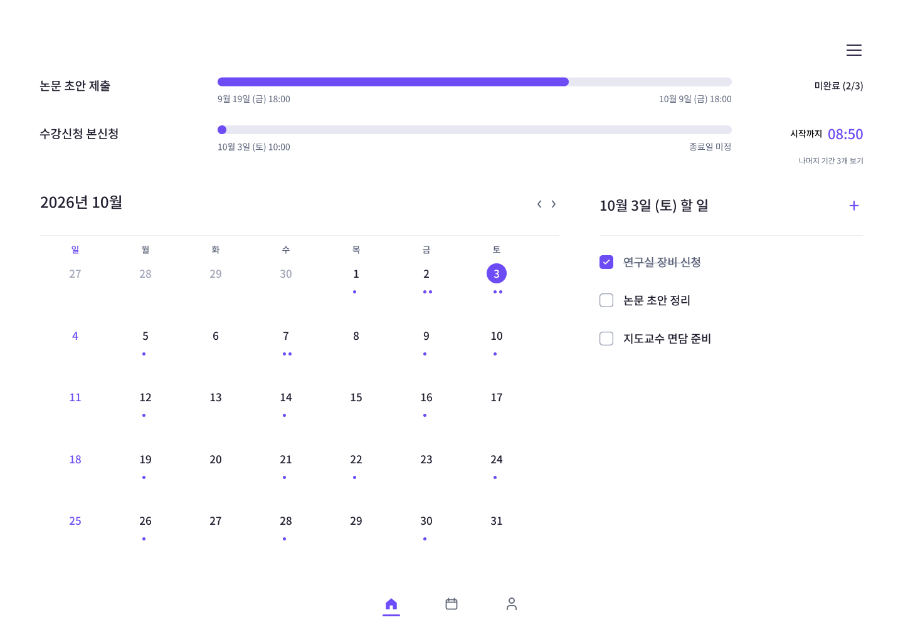
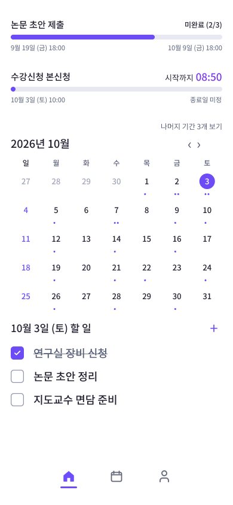

# 구현 설계 시작점

작성 기준: 2026-10-03 · 상태: 구현 진행 중 · 통합 설계 기준 문서

이 문서는 전체 구현 설계의 읽기 시작점이다. 제품·플랫폼·화면·저장 계약의 기준 문서로 연결하고, 상세 계약을 다시 정의하거나 기능 범위를 줄이지 않는다.

**2026-10-05 화면 개정:** 새 데스크톱 배치·기간 메뉴·주간 시간표·설정·Figma 선행 컴포넌트 기준은 [07 데스크톱 컴포넌트 시스템 설계](07-component-system-design.md)다. 이 문서와 03 전달 문서에 남은 상충하는 화면 구절보다 07을 우선한다. 사용자가 문서를 검토하기 전까지 Figma/코드는 수정하지 않는다. 기존 domain/repository/시간/ICS 저장 계약은 계속 유효하다.

## 무엇을 만들지

Next.js 16 App Router 정적 화면을 브라우저 미리보기로 먼저 제공한다. 현재 검수는 macOS용 compact desktop UI와 로컬 CRUD를 목표로 하며 Firebase 계정 간 동기화는 후속 범위다. 기존 Firebase Auth/Firestore 아키텍처와 네 item 유형은 유지하되 이번 화면 검수 성공 조건으로 요구하지 않는다. iOS 배포와 네이티브 macOS 패키징은 화면 검수 뒤 결정한다.

홈은 월간 날짜별 task, 선택일 task, 다음 관련 시간 경계가 가까운 미완료 기간 최대 세 개를 보여준다. 햄버거에서 선착순 신청과 기간 내 할 일을 추가한다. 초과 기간은 홈을 밀지 않는 3열 겹침 오버레이에서 확인한다. 중앙 캘린더 아이콘은 요일·시각 눈금이 있는 주간 시간표를 연다. 840px 콘텐츠 기준 폭, settings 선호도, 구성요소별 Figma/구현 계약은 07을 따른다. 날짜·시간·저장·충돌·ICS 계약은 기존 기준 문서를 따른다.

현재 checkout에는 Next.js 정적 PWA 셸, 도메인·Rules·저장 경계, 주요 화면, PWA update flow, ICS 미리보기·커밋 UI와 JSON export가 있다. 기존 검증 결과는 [검증 보고](verification.md)에 기록되어 있다. 새 화면 방향에 맞춘 Figma/구현 비교와 macOS 검수는 아직 진행 전이며, 기존 Firebase/iOS 검증은 현재 화면 설계의 완료를 대신하지 않는다.

## 문서 읽기 순서

| 순서 | 문서 | 구현자가 확인할 내용 |
|---|---|---|
| 1 | [프로젝트 개요](../README.md) | 제품 목표, 문서별 결정 권위 |
| 2 | [02 제품 요구사항](../02-product-spec.md) | 네 유형, FR-01~16, 시간 의미, ICS 지원 범위 |
| 3 | [03 UX·프론트엔드](../03-ux-frontend.md) | route, 화면 흐름, 상태와 접근성 |
| 4 | [04 데이터·동기화](../04-firebase-data-sync.md) | domain types, repository, Rules, journal, 백업 |
| 5 | [05 카운트다운·네이티브 로드맵](../05-alerts-native-roadmap.md) | V1 화면 카운트다운과 후속 알림 경계 |
| 6 | [06 검증·개발 순서](../06-validation-delivery.md) | 수용 기준과 테스트 ID |
| 7 | [01 플랫폼 조사](01-platform-research.md) | static export, OAuth, emulator, PWA, Node/pnpm 근거 |
| 8 | [02 ICS 구현 경계](02-import-time-research.md) | 지원 subset, 시간대·DST 정책, 미리보기 한도, import identity와 부분 성공 계약 |
| 9 | [03 프론트엔드 전달](03-frontend-delivery.md) | 화면 컴포넌트, state owner, visual QA |
| 10 | [04 핵심 구현 계약](04-core-implementation.md) | 시간, projection, journal, Firestore transaction/Rules hard contract |
| 11 | [06 실행 계획](06-execution-plan.md) | 단계 순서, 파일 소유권, task별 테스트와 실행 기록 |
| 12 | [07 데스크톱 컴포넌트 시스템](07-component-system-design.md) | 최신 화면 계약, Figma 선행, 모든 컴포넌트·버튼 행동과 기준 뷰포트 |
| 12 | [07 데스크톱 컴포넌트 시스템](07-component-system-design.md) | 최신 화면 계약, Figma 선행, 모든 컴포넌트·버튼 행동과 기준 뷰포트 |

기능 의미는 02, UI 동작은 03, 데이터 schema는 기존 04, 알림은 05, 수용 기준은 06이 권위 문서다. 구현 contract의 hard algorithm과 repository/store file map은 04-core가 권위다. 이 문서는 그 사이의 탐색·구조 안내이며 상세 contract를 재설계하지 않는다.

ICS의 큰 흐름은 브라우저 파일 parse → preview → occurrence 선택 → 멱등 저장, unsupported/error와 부분 성공 분리다. 지원 RRULE, 시간대 처리, 한도, identity, 행별 문구는 [02 ICS 구현 경계](02-import-time-research.md)와 02 제품 요구·04 data contract를 따른다.

## 승인된 시각 자료

이전에 저장한 archive는 [데스크톱 홈 7:4](https://www.figma.com/design/o81oyODBLYZuzBAkKcWqgp?node-id=7-4)와 [iOS 홈 7:247](https://www.figma.com/design/o81oyODBLYZuzBAkKcWqgp?node-id=7-247)다. 사용자가 편집 중인 [선택된 3개 기간 보드](https://www.figma.com/design/o81oyODBLYZuzBAkKcWqgp?node-id=84-467)와 [확장 오버레이](https://www.figma.com/design/o81oyODBLYZuzBAkKcWqgp?node-id=84-584)가 최신 방향이다. 최신 desktop 컴포넌트/프레임은 문서 검토 후 갱신하며 세부는 07을 따른다.

Figma 색상·실측 크기·빈 상태와 종료 미정 레일은 [03 UX 문서](../03-ux-frontend.md)와 [03 프론트엔드 전달](03-frontend-delivery.md)을 따른다. 샘플 요일과 시간은 테스트 데이터로 복사하지 않고 fake clock과 달력상 맞는 fixture를 사용한다. 전달된 디자인 frame은 홈 두 화면이므로 캘린더/settings의 구체 픽셀 배치는 추측하지 않는다.

## 화면 route

기존 route별 화면 형태보다 07의 route 표와 컴포넌트 동작을 따른다. `/calendar`는 월/주 전환 화면이 아니라 주간 시간 그리드다. Firebase 로그인·계정 동기화 UX를 새 UI 검수 범위에 확장하지 않는다.

| Route | 책임 |
|---|---|
| / | 월간 할 일 홈, 임박 기간 상단 3개와 초과 목록 오버레이, 선택 날짜 task |
| /calendar | 07 문서가 정의하는 요일·시각 축 주간 시간표 |
| /calendar?filter=period | 07의 전체 기간 상태별 목록 |
| /tasks | 모든 task와 날짜 미정 task |
| /settings | 07 문서가 정의하는 로컬 시간·주간 보기·알림·데이터 환경설정; Firebase 계정/동기화는 후속 |

item 상세/편집은 정적 route를 새로 만들지 않고 route query의 opaque item ID로 열린다. query에는 월·선택 날짜·view/filter·item ID만 둔다. UID, 제목, 메모, 시각 원문과 OAuth code는 URL에 넣지 않는다. /tasks는 하단 navigation이 아니며 날짜 미정 링크와 추가 메뉴에서 진입한다. 하단 중앙에는 home/weekly-calendar/settings 아이콘 세 개를 둔다. 별도 /account route는 추가하지 않는다.

Next.js는 output export 및 직접 경로 진입 가능한 /, /calendar/, /tasks/, /settings/ 산출을 사용한다. 사용자별 server route, Server Action, runtime cookie/header, 일반 catch-all rewrite를 만들지 않는다. Firebase Hosting Emulator에서 각 경로 직접 열기와 refresh를 확인한다.

## 프론트엔드와 저장 계층

| 경계 | 권위 경로 | 역할 |
|---|---|---|
| Static routes/shell | src/app | pages, metadata, client provider composition |
| 순수 도메인 | src/domain | item types, runtime validation, time, projection |
| 인증 | src/auth | Google Auth client, redirect result와 UID generation |
| 공개 저장 경계 | src/lib/repository.ts | 04-core의 createRepository(session, ports), saveDraft와 repository 공개 contract |
| 내부 저장 adapter | src/lib/storage | IndexedDB journal, Firestore listener/transaction, sync lifecycle |
| 화면 기능 | src/features | shell, home, calendar, tasks, items, sync, import, account/settings |
| static assets | public | manifest, icons/fonts, static worker output |
| Rules/hosting | firestore.rules, firestore.indexes.json, firebase.json | UID 격리, item/receipt 제약, emulator, static hosting |

흐름은 Firebase Auth UID → generation-scoped repository → Firestore snapshot + UID-scoped IndexedDB journal → src/domain projections → React feature다. UID 변경 시 이전 listener, timer, import worker와 flush를 종료하고 늦은 결과가 새 계정 UI에 섞이지 않게 한다. Feature/UI는 Firebase SDK, journal store 또는 remote adapter를 직접 가져오지 않고 repository 공개 경계만 사용한다.

Firestore persistentLocalCache는 오프라인 조회 snapshot으로 사용한다. canonical 변경은 IndexedDB journal transaction commit 후 online runTransaction으로만 전송한다. setDoc/updateDoc/deleteDoc canonical write 경로를 만들지 않으므로 SDK offline write queue를 저장 기능으로 사용하지 않는다. transaction은 오프라인일 때 실패하며 core contract의 operation/receipt/retry 규칙을 따른다. Cache-only snapshot은 server 최신 상태로 표기하지 않는다.

## 파일 map

도메인과 저장 경로는 04-core에 정의된 이름을 그대로 쓴다. 최신 UI component map은 07을 따른다. 표의 기존 파일 책임은 data/backend 경계 설명에 사용하고 새 화면 배치는 07에서 갱신한다.

| 파일/경로 | 책임 |
|---|---|
| next.config.ts | static export, trailing slash route output |
| src/app/layout.tsx | metadata, viewport, shared shell |
| src/app/globals.css, src/styles/tokens.css | global reset plus shared CSS custom-property tokens |
| src/app/providers.tsx | client auth/repository composition |
| src/app/page.tsx, src/app/calendar/page.tsx | 홈과 캘린더 route |
| src/app/tasks/page.tsx, src/app/settings/page.tsx | task 및 account/settings route |
| src/domain/items.ts | CalendarItem, ProposedCalendarItem, PeriodChecklistItem |
| src/domain/validation.ts | unknown 입력, field/size/cross-field 검증 |
| src/domain/time.ts | timezone, D-Day, progress와 countdown |
| src/domain/projections.ts | home periods, day tasks, agenda/filter selector |
| src/auth/client.ts, src/auth/session.ts | browser-only Google Auth와 redirect 복귀, UID generation/session lifecycle |
| src/lib/errors.ts, src/lib/firebase/config.ts | 도메인 repository 오류와 공개 config/emulator mode validation |
| src/lib/repository.ts | createRepository(session, ports), saveDraft 등 04-core UI 공개 API |
| src/lib/storage/contracts.ts | 공개 PendingDraft를 참조하는 journal/remote port와 내부 result types |
| src/lib/storage/journal.ts | native IndexedDB atomic journal, recovery, ack |
| src/lib/storage/firestore.ts | persistent read cache, snapshot listener, receipt-first online transaction |
| src/lib/storage/sync.ts | immutable operation 전송 순서, retry/successor/conflict |
| src/features/shell/* | AppShell, bottom navigation, SyncStatus |
| src/features/shell/useForegroundClock.ts, src/features/shell/UpdatePrompt.tsx | foreground clock lifecycle, 안전한 명시적 PWA update action |
| src/features/home/* | MonthTaskGrid, PeriodProgressSummary, SelectedDayTasks |
| src/features/calendar/* | CalendarMonthView, SelectedDayAgenda, PeriodList, ICS entry |
| src/features/tasks/AllTasks.tsx | 전체/날짜 미정 task |
| src/features/items/* | ItemEditor, ItemDetailDialog, ChecklistEditor |
| src/features/sync/*, src/features/import/* | ConflictDialog, ICS preview/import |
| src/features/import/contracts.ts, ics.worker.ts, parser.ts, identity.ts | ICS contracts, browser parse worker, parser와 stable source identity |
| src/features/account/* | /settings 콘텐츠, 계정 전환/export/cache 관리 |
| src/features/*/*.module.css | feature별 CSS Modules |
| src/pwa/client.ts, src/pwa/service-worker.ts, out/sw.js | PWA client lifecycle, worker TypeScript source와 build 산출 |
| scripts/generate-sw.ts, tsconfig.sw.json | out/ 해시 자산 precache 생성과 worker 전용 typecheck 설정 |
| public/manifest.webmanifest, public/design/*.svg, public/icons/*, public/fonts/* | 설치 정보·승인된 Figma 정적 아이콘·앱 아이콘·라이선스가 확인된 Noto Sans KR |
| firestore.rules, firestore.indexes.json | UID/item/receipt 규칙과 인덱스 |
| firebase.json, .firebaserc | Auth/Firestore/Hosting Emulator 및 배포 설정 |
| .env.example | public Firebase config와 emulator 모드 예시, secret 없음 |
| package.json, pnpm-lock.yaml, tsconfig.json, eslint.config.mts | pinned scripts/versions, type/lint |
| tests/domain/*, tests/storage/*, tests/ui/*, tests/rules/*, tests/integration/*, tests/e2e/* | unit/component, Emulator, browser test |

03 초안과 경로가 다를 때 도메인/저장 파일명은 이 표와 04-core를 기준으로 한다. 화면 컴포넌트는 03의 책임대로 두되 시간·순위 logic을 src/lib에 중복 구현하지 않는다.

## 스타일, hydration, browser API

- 화면은 CSS Modules와 `src/styles/tokens.css`의 CSS custom properties를 사용하며 `src/app/globals.css`에서 reset한다. Tailwind, CSS-in-JS, 추가 UI/calendar/icon/state package는 설치하지 않는다. semantic HTML, CSS Grid/Flexbox와 native button을 사용한다. Figma 정적 아이콘은 원본 SVG 파일로 보존해 정확한 슬롯/치수에 쓰고 새 SVG로 다시 그리지 않는다.
- Tokens: background #FFFFFF, lavender #6E4DF5, track #E8E8F2, primary #211F30, secondary #596178, muted #A1A6B8, outline #8F96AD. Noto Sans KR을 사용하고 03의 대비·focus·터치 조건을 따른다.
- route/layout은 static pre-render한다. module 평가나 server render에서 사용자 데이터/Auth state/URL/browser storage를 읽지 않는다. 안정적인 empty/loading shell을 만든 뒤 client effect에서 Auth와 repository listener를 시작한다.
- React hook, auth listener, URL navigation, IndexedDB, service worker, page visibility, Blob/URL API를 쓰는 client boundary 파일은 첫 줄에 use client를 둔다. window/navigator/IndexedDB/localStorage는 mount 이후 또는 guarded event/effect에서만 접근한다.
- 최초 prerender markup과 hydration markup을 일치시킨다. Auth UID와 snapshot source를 확정하기 전은 skeleton/cache status로 보이고, 빈 offline cache를 “일정 없음”으로 표시하지 않는다.
- query state는 hydration 이후 client router로 복원한다. query에는 월·날짜·view/filter·opaque item ID만 포함한다.
- reduced motion, visible focus, modal focus 이동/복귀, 달력 roving focus, 최소 44×44px touch target, 색 외 상태 표현은 03의 기준으로 한다.

| 상태 | 단일 owner |
|---|---|
| Google UID, auth redirect/result, session generation | src/auth adapter와 app providers |
| canonical, persistent read cache source, pending/sending journal, conflict snapshots | src/lib/repository.ts public subscription |
| month, selected date, calendar view/filter, opaque item detail ID | URL query/router state |
| editor draft, open menu/modal, checklist form, selected ICS rows | 해당 src/features page/component React state |
| now, D-Day/countdown/progress, calendar/period projection | shared clock input + src/domain 순수 계산. 결과를 mutable React copy로 저장하지 않음 |
| service worker install/update readiness | PWA lifecycle coordinator. user action 없이 activation/reload하지 않음 |

## Google Auth와 emulator 개발

Firebase Web SDK Google provider를 사용한다. iOS Safari 및 홈 화면 PWA는 redirect 후 app boot의 getRedirectResult와 auth state subscription을 처리한다. macOS에서는 popup 또는 redirect를 검증한다. 실제 배포 host 하나를 정하고 Firebase Authorized Domains와 Google redirect allowlist에 해당 HTTPS origin 및 /__/auth/handler 경로를 등록한다. Safari tab과 설치형 PWA의 origin storage를 공유한다고 가정하지 않는다.

Local 개발은 Firebase Auth/Firestore Emulator Suite에 연결한다. .env.example에는 공개 web config와 emulator host 설정을 기록하되 secret을 저장하지 않는다. 실제 Firebase live project credential이 없어도 demo project ID와 emulator용 placeholder public config를 명시해 Rules/repository 개발을 진행한다. 반대로 Firebase config와 Emulator host가 모두 없으면 fake Google sign-in, fake sync, demo mode, in-memory fake repository를 띄우지 않고 필요한 Emulator/config 설정을 안내한다. Emulator test identity는 자동화용이며 실제 Google OAuth의 iOS redirect 동작을 증명하지 않는다.

예정 개발 흐름은 pnpm emulators:start로 Auth/Firestore Emulator를 실행한 다음 pnpm dev를 emulator mode로 구동한다. pnpm test는 firebase emulators:exec로 suite를 자동 시작/종료하고 그 안에서 raw pnpm test:rules를 호출한다. 실제 Google OAuth는 별도 iPhone 검증에서 확인한다. Firebase Storage, Functions, App Hosting, server API 및 결제 SDK는 V1 범위가 아니다.

## Local-first 저장과 계정 경계

[04-core-implementation](04-core-implementation.md)의 타입·signature·전이는 기준으로 고정한다. 이 섹션은 화면 연결 규칙만 요약한다.

1. “기기에 저장됨”은 IndexedDB transaction complete 뒤에만 표시한다. 저장 실패는 입력을 유지하고 재시도/export를 제공하며 canonical server write로 우회하지 않는다.
2. SyncState는 local/cache/pending/sending/server-confirmed/conflict/failed/auth-required를 구분한다. server snapshot 또는 receipt 확인 뒤에만 synced라고 표시한다.
3. Online commit은 고정된 operation snapshot을 receipt-first runTransaction으로 제출한다. callback replay는 UI/journal side effect가 없어야 한다.
4. revision 충돌은 base/local/remote를 보존하고 서버 유지, 내 변경 재적용, 두 판본 직접 편집을 제공한다. tombstone ID는 부활시키지 않고 사용자가 선택해 새 ID로 복구한다.
5. UID 전환 시 UI를 먼저 비우고 구 UID listener/flush를 해제한다. 미전송 작업은 구 UID namespace에 남아 새 UID로 표시·전송되지 않는다. 로그아웃/정리 시 flush, JSON 보존, UID별 유지, 명시적 폐기 선택을 안내한다.
6. JSON export는 repository에서 현재 UID canonical과 pendingLocalChanges를 별도 배열로 만든다. 온라인 server snapshot인지 device cache인지 source를 기록하고 format version, timezone, import identity를 보존한다. export는 브라우저 다운로드뿐이며 서버 업로드, analytics/logging, 자동 restore/merge, secure erase 보장은 없다. 임시 Blob URL은 해제한다.
7. Cache clear는 미전송 변경 처리와 Firestore terminate/clear 순서를 거친 별도 사용자 행동이다. SDK cache와 custom journal을 함께 삭제하지 않는다.

## PWA update와 화면 카운트다운 범위

Service worker는 hashed JS/CSS, 필요한 route HTML, icons/fonts와 같은 정적 shell만 precache한다. Firebase /__/ reserved Auth 경로, OAuth redirect, Firestore/Auth 요청·응답, 사용자 일정은 service worker cache/fallback에서 제외한다.

새 worker 활성화 전 dirty form draft와 모든 pending operation이 UID journal에 durable한지 확인한다. 저장 중이거나 실패했다면 현재 화면을 보존하고 activation을 지연한다. “지금 업데이트”를 사용자가 선택했을 때만 skipWaiting()을 호출한다. install/activate/controllerchange/cache version 교체만으로 자동 reload하지 않는다. 업데이트가 준비되었다는 상태와 별도 재시작 action을 제공한다. 정적 cache 정리에서 journal을 지우지 않는다.

화면 카운트다운과 진행 상태는 foreground에서 주입된 현재 시각 기준으로 계산한다. visibility 복귀 시 잔여 시간을 다시 계산한다. Firebase V1 item schema에는 ReminderRule·notice가 없다. 로컬 미리보기는 별도 localStorage 설정으로 알림 기본 꺼짐, 항목별 시점 선택과 browser Notification을 제공하되 앱이 열려 있는 동안만 확인한다. 알림 permission, OS 예약, 닫힌 앱 push는 제공하지 않으며 네이티브 로컬 알림과 서버 push는 후속 결정이다.

## [ASSUMPTION] dependency와 버전 정책

새 package.json이 없으므로 exact version을 지금 지정하거나 설치하지 않는다. production dependency 후보는 아래 목록으로 제한한다.

| 패키지 | 후보 이유 |
|---|---|
| next | Next.js 16 product floor, implementation 시 지원되는 stable patch |
| react | React 19 product floor |
| react-dom | 동일 React 19 patch |
| firebase | browser Auth/Firestore client SDK |
| @js-temporal/polyfill | 지원 Safari의 native 시간 API만으로 core timezone/DST contract를 만족하지 못할 때만 |
| ical.js | RFC 5545 지원 subset을 브라우저에서 안전히 처리할 기존 대안이 없을 때만 |

실제 scaffold 때 유지 중인 stable patch, Next 16/React 19 compatibility, 지원 Node version, license, bundle size와 native/existing alternatives를 조사해 정확한 package versions와 pnpm lockfile을 고정한다. 사용 가능한 현재 버전은 설치 시 공식 release 문서로 다시 확인한다. [01 플랫폼 조사](01-platform-research.md)는 Node 24 LTS 등을 해당 조사일에 기록했으므로 그대로 적용하지 말고 재검증한다.

추가 dev dependency 후보는 vitest, @testing-library/react, fake-indexeddb, @firebase/rules-unit-testing, firebase-tools, @playwright/test, TypeScript, ESLint CLI/config, TypeScript config 로딩용 jiti와 build-script 실행용 tsx다. V1은 CSS Modules/native IndexedDB/React state를 사용한다. Tailwind, CSS-in-JS, UI framework, icon/calendar package, Redux/Zustand, IndexedDB production wrapper, background notification package는 후보에 넣지 않는다. 후보 사용은 설치 승인이 아니다. production dependency PR에는 반드시 [ASSUMPTION], 필요성, native/existing 대안, license를 적는다.

## 예정 scripts

아래 명령은 package.json에서 생성할 계획이며 현재 실제 script가 있거나 성공했다는 뜻이 아니다.

사용자 지시(2026-10-03)에 따라 일반 기능은 먼저 구현하고 필요한 회귀·흐름 검증을 추가한다. TDD는 어려운 시간/DST 계산, Firestore Rules·멱등 트랜잭션, IndexedDB 동기화, ICS 반복·시간대·부분 재시도(Task2/3/4/7)에만 적용한다. ICS 오류는 날짜 이동과 가져오기 중복·유실 위험이 있어 데이터 무결성에 직접 영향을 준다. 필수 완료 명령은 그대로 유지하며 스타일·설정 값을 복제하는 테스트를 추가하지 않는다.

| Command | 구현 후 동작 |
|---|---|
| pnpm dev | Next dev server. Auth/Firestore Emulator mode 명시. 설정이 없으면 setup 안내 |
| pnpm emulators:start | Auth 및 Firestore Local Emulator Suite 실행 |
| pnpm test:unit | Vitest pure domain/component suite |
| pnpm test:rules | 이미 실행된 demo Emulator에 연결하는 Vitest Rules/repository 통합 suite. 별도 Emulator를 중첩 시작하지 않음 |
| pnpm test | unit suite + Emulator test 자동 실행. CI의 기본 테스트 |
| pnpm test:e2e | emulator identity를 쓰는 Playwright browser flow |
| pnpm typecheck | TypeScript no-emit |
| pnpm lint | ESLint CLI 실행. Next 16의 제거된 next lint command 사용 금지 |
| pnpm build | Next static export, PWA manifest/worker output, out/ 경로 확인 |

pnpm은 packageManager 필드로 정확한 버전을 pin하고 pnpm-lock.yaml 및 CI frozen-lockfile install을 사용한다. Emulator tests는 실제 Firebase project나 사용자의 Google credential에 의존하지 않는다. iOS 실기기 Google OAuth는 e2e를 대체하지 않으며 별도로 확인한다.

## FR-01~FR-16 완료 조건

| FR | 구현 경계 | 완료 조건과 검증 ID |
|---|---|---|
| FR-01 | auth/repository/Rules | Google redirect 복귀, 동일 UID 기기간 데이터 공유, 타 UID item/receipt 접근 거부; AUTH-01~03, SYNC-01 |
| FR-02 | domain projections/home/calendar/shell | 07의 월간 task 홈, 기간 최대 3 + 3열 겹침 overlay, 주간 시간표, home/calendar/settings nav; UI-01~03, UI-06~08 |
| FR-03 | validation/ItemEditor/repository | 네 유형 CRUD/tombstone, 각 kind required fields와 field error; DATA-01~03 |
| FR-04 | detail/checklist projection | task 및 제출/신청은 명시적으로 완료, event checkbox 없음, checklist와 부모 완료 독립; DATA-04, DATA-06 |
| FR-05 | domain time/countdown selector | date-only calendar D-Day, instant actual countdown, 1일 기본/0~30 설정/정확한 단위 경계; TIME-01~05, TIME-10~13, TIME-15 |
| FR-06 | domain time/PeriodProgressSummary | 유효한 start+end만 clamp progress, 양 끝 시각과 accessible value, end 미정 시작 레일은 비율 아님; TIME-06~08, UI-04 |
| FR-07 | domain projections/home/filter | 상단 3개 고정, 초과 항목은 3열 overlay, phase 변화에서만 재정렬, hidden count 정확, 완료 제외/period filter 완료 포함; TIME-09, TIME-14, UI-08 |
| FR-08 | local reminder setting/scheduler | 로컬 preview 설정에서 선택 가능·기본 꺼짐; 항목별 시점과 브라우저 권한을 확인; 앱이 열린 동안만 전달; Firebase와 닫힌 앱 알림은 후속 |
| FR-09 | import preview/repository | 브라우저 file→preview→선택 import, UID/occurrence 중복, timezone/all-day/반복 subset/error/partial success; ICS-01~09 |
| FR-10 | journal/SyncStatus | IndexedDB 완료 뒤 saved, 오프라인 변경 재실행 복원, 실패 시 입력 보존; SYNC-02~04, SYNC-10 |
| FR-11 | sync/ConflictDialog | base/remote/local 판본 보존, 자동 merge/LWW 없음, 3종 해결, tombstone 복구는 새 ID; SYNC-05~09, SYNC-11~13 |
| FR-12 | repository state/SyncStatus | local/cache/pending/syncing/server-confirmed/conflict/fail/auth 구분; SYNC-10, UI-05 |
| FR-13 | CSS Modules/interactions | desktop/mobile/intermediate, keyboard, 44px touch, VoiceOver/status, 확대와 색 이외 상태; UI-01~07 |
| FR-14 | settings/export/cache controls | 현재 UID만, canonical/pending 분리와 source metadata, cache clear/로그아웃 전 미전송 작업 선택; DATA-05, AUTH-03 |
| FR-15 | ChecklistEditor/domain validation/Rules | checklist CRUD/derived status, 항목당 최대4개를 client+Rules에서 검증하고 초과 입력 보존; DATA-06~07, SYNC-11 |
| FR-16 | period editor/domain time | start display enabled/daysBefore=0..30, 알림 예약과 분리; TIME-10~13, TIME-15 |

제품 요구, 입력 의미, ICS subset, 충돌, PWA lifecycle은 선택 기능이나 polishing이 아니다. 범위를 바꾸려면 영향을 받는 FR와 검증 조건을 함께 바꾼다.

## 자동 검증과 실제 iPhone 검증

이전 자동 visual QA 기록은 1440×1024 및 390×844를 포함한다. 새 UI 검수는 07의 1000×780 화면별 캡처와 넓은 창에서 고정 폭이 유지되는지를 우선하며, iOS/실기기 확인은 현재 완료 조건이 아니다.

Browser suite는 각 static route 직접 진입/refresh, query 복원, empty/loading/offline/conflict/error state, 홈 단일 +, task/event checkbox 경계, hidden overflow link, bottom navigation 가림을 확인한다. Keyboard suite는 달력 화살표/Home/End/Enter/Space, tab/focus ring, modal focus trap/restore/Escape를 확인한다. Screen reader가 매초 countdown을 읽지 않는지 검사한다.

실제 iPhone에서는 Safari tab과 standalone PWA를 별도로 설치해 Google redirect/취소/앱 복귀, 저장소 분리, local journal relaunch, offline write/reconnect, 두 기기 sync, UID A→B 전환, 회전/확대, 44px target, VoiceOver, visibility 복귀를 확인한다. Emulator와 Playwright는 실제 Google OAuth 및 iOS 저장소 동작을 대신하지 않는다.

## 모델 책임 분담

| 작업자 | 담당 |
|---|---|
| 현재 에이전트 모델 상속 | scaffold, CSS tokens/Modules, shell/routes, screens, CRUD UI, PWA shell/update UI, UI/단위/e2e scripts 및 구현 문서 |
| gpt-6.1-sol xhigh | 시간/DST, Rules·receipt, IndexedDB journal/conflict, ICS recurrence·timezone·identity/retry 구현, 고난도 실패 시나리오 및 최종 통합 판단 |
| 공유 지점 | 일반 구현자는 04-core의 타입·signature를 재정의하지 않고 소비한다. shared file은 주 에이전트의 [06 execution plan](06-execution-plan.md)에서 순서를 지정한다. ICS hard task도 확정된 repository 계약을 사용한다. |

## 현재 상태

- 이 문서는 설계 안내다. 앱 코드, package.json, lockfile, Firebase project config, Rules, Emulator scripts는 아직 생성되지 않았다.
- package를 설치하거나 테스트·typecheck·lint·build를 실행했다고 주장하지 않는다.
- [01 platform research](01-platform-research.md)와 [02 ICS implementation boundary](02-import-time-research.md)를 함께 읽는다. 제품 사양과 04-core 계약이 우선이며 ICS 세부 parser·timezone·identity 동작은 02 조사/설계를 따른다.
- 제품 source는 02/04/05, UX source는 03, acceptance source는 06, core function/file contracts는 04-core다. 이 문서는 링크와 implementation map만 통합한다.
