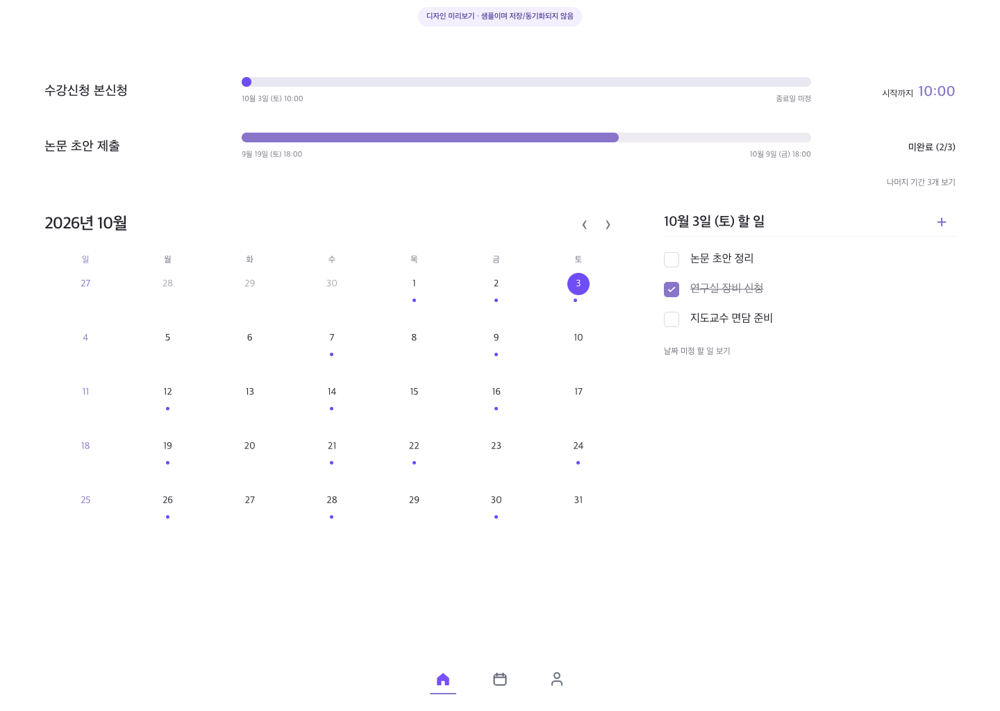
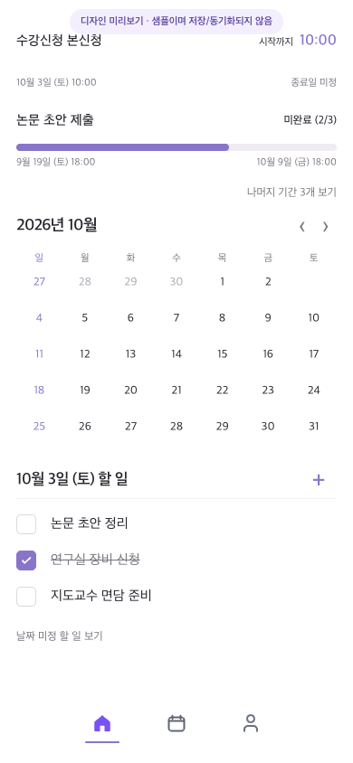
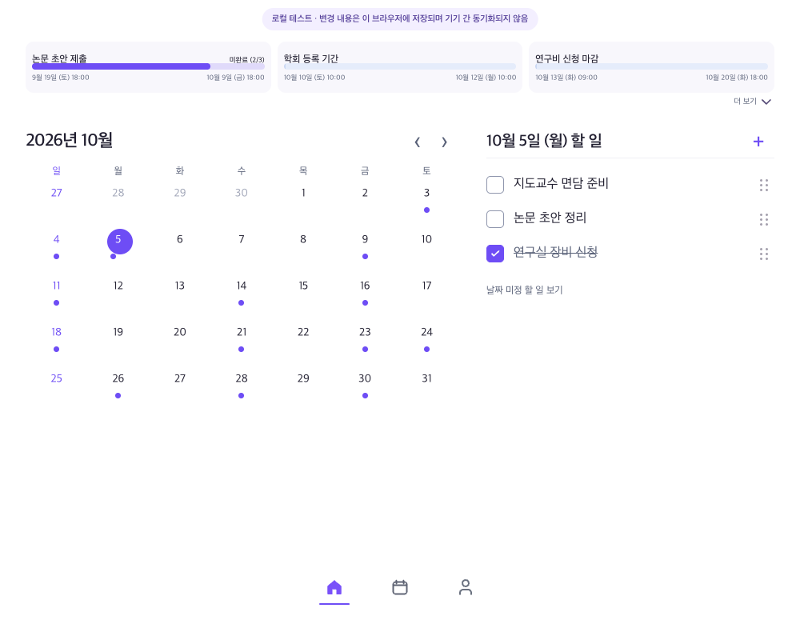

# 구현 검증과 화면 비교

검증일: 2026-10-05 · Asia/Seoul

## 최신 코드 검증 상태

이전 표와 캡처는 과거 구현 시점의 결과다. 최근 컴포넌트 분리·날짜 미정 task 순서·대화상자 초점 처리 이후 검증은 다음과 같다. 이전 Chromium 캡처는 화면 폭과 기간 펼침 방향이 현재 CSS와 달라 최신 시각 승인으로 간주하지 않는다.

| 확인 항목 | 최신 결과 |
|---|---|
| `pnpm test:unit` | 통과: 16개 파일, 213개 테스트 |
| `pnpm typecheck` | 통과 |
| `pnpm lint` | 통과, 오류·경고 없음 |
| `pnpm build` | 통과: 정적 route 생성, service worker typecheck 및 생성 |
| `git diff --check` | 통과 |
| `pnpm test` 전체 | unit 단계 통과. Firestore Emulator는 Java Runtime이 없어 시작되지 않음 |
| `pnpm test:e2e` | 최신 변경 이후 미실행 |
| 최신 Figma/앱 캡처 대조 | 미실행. Figma 편집과 앱 화면 열기 요청은 자동 검토에서 현재 모델 용량 문제로 거부되어 기존 캡처를 재사용하지 않음 |

포트 `3001`은 이미 사용 중이라고 반환했다. 기본 샌드박스에서는 해당 포트 HTTP health check가 차단되어 현재 응답이 최신 코드인지 확인할 수 없다. 코드 변경과 정적 build는 성공했다. 프리뷰 확인 주소는 `http://127.0.0.1:3001/?preview=design`이다.

이 문서는 이 checkout에서 실행한 자동 검증과 Figma 비교용 화면을 기록한다. 앱 코드 자동화는 통과했지만 실제 Firebase 프로젝트·Google OAuth, 실제 iPhone 설치·백그라운드 복귀는 이 결과에 포함하지 않는다.

## 이전 구현 시점의 자동 검증 기록

| 확인 항목 | 결과 | 범위 |
|---|---:|---|
| `pnpm test` | 통과 · unit 202/202, Firestore Rules/통합 76/76 | Vitest와 `demo-todolist` Auth/Firestore Emulator |
| `pnpm typecheck` | 통과 | 앱 TypeScript 전체 |
| `pnpm lint` | 통과 · 오류/경고 없음 | ESLint |
| `pnpm build` | 통과 | 독립 production build; Next.js 정적 route 4개, service worker 타입 검사·생성 |
| `pnpm test:e2e --project=chromium` | 통과 · 18/18 | 정적 export와 실제 Auth/Firestore Emulator를 연결한 Chromium; 로컬 preview CRUD·알림 설정·알림 1회 전달·홀드 재정렬 포함 |

E2E는 비밀번호 방식의 일회성 Auth Emulator 사용자로 Firebase SDK 세션을 만들고 Firestore Emulator Rules, 실제 browser IndexedDB와 service worker를 사용한다. 브라우저 요청은 로컬 E2E origin과 Emulator 외부에서 차단한다. 환경 검사도 `demo-todolist`가 아니거나 실서비스 Firebase 환경변수가 발견되면 빌드 전에 종료한다. Google redirect 로그인과 실제 iOS Safari를 대신 검증한 것은 아니다.

실행 명령은 저장소 안내에 맞춰 다음과 같다. 위 build는 E2E가 사용하는 `scripts/serve-export.ts` 경로에서 production build script를 실행해 확인했다. Playwright 전용 `NEXT_PUBLIC_E2E_DESIGN_PREVIEW=true` 외에는 demo Emulator 환경이며, 일반 개발 서버는 계속 별도로 실행 중이다. Emulator 테스트에는 JDK 21과 localhost 포트 바인딩 권한이 필요하다.

```sh
pnpm test
pnpm typecheck
pnpm lint
pnpm build
pnpm test:e2e --project=chromium
```

Playwright 정적 테스트 build에서만 `NEXT_PUBLIC_E2E_DESIGN_PREVIEW=true`를 넣어 preview UI를 테스트한다. 일반 production build에서는 query만으로 이 fixture를 노출하지 않는다. `/?preview=design`은 개발 서버의 로컬 데스크톱 미리보기이며 항목·완료·순서·알림 선호를 이 브라우저에 저장한다. Firebase 또는 기기 간 동기화는 하지 않는다. 예시 fixture는 실제 날짜에 맞춰 이동되며 Playwright는 `Asia/Seoul` 고정 시각을 사용한다.

## 이전 구현 시점의 Figma/화면 비교 기록

원본: [Figma 데스크톱 홈](assets/figma-home-desktop.png), [Figma iOS 홈](assets/figma-home-ios.png). 아래 캡처는 과거 UI 구성의 고정 fixture를 1440×1024와 390×844로 렌더링한 Chromium 화면이다. 최신 fixed-width 데스크톱 구현을 증명하지 않는다.

### 데스크톱 · 1440×1024



### 모바일 · 390×844



### TodoMate 창 기준 · 1000×780



과거 수정 후 캡처에서 문서 크기는 viewport와 동일했고 월간 할 일·선택일 목록은 두 열로 배치됐다. 당시 2000×1564 화면에서 workspace 폭을 1760px로 확장했으나 이는 현재 840px 고정 폭 계약과 다르다. 위치·겹침·잘림 검토는 [UI 감사](ui-audit/current-ui-audit.md)를 참고한다. 최신 코드는 [09 UI 감사·구성요소 동작](09-ui-audit-and-component-behavior.md) 기준으로 새 캡처가 필요하다.

두 화면 모두 흰 배경, Figma와 일치하는 라벤더 진행 바, 월간 TodoMate식 날짜 탐색, 선택일 할 일, 아이콘만 있는 중앙 하단 내비게이션을 유지한다. 기간은 홈 할 일 목록과 분리되며 상단에 3개를 고정하고 초과 기간은 캘린더를 밀지 않는 3열 오버레이로 연다. 경과율, 시작 카운트다운, 체크리스트 상태는 서로 다른 의미로 표시한다. 추가 E2E는 정확 시각 접수 기간을 만들어 `00:10`에서 앱 복귀 후 `09:59`, 마지막 `00:01`, 시작 시 숨김으로 갱신되는 것을 확인했다. 프리뷰에서 CRUD·순서·완료·알림 선호가 이 브라우저에 남는 것도 확인했다. 알림 테스트는 기본 꺼짐 상태와 설정 저장, 사용자가 켠 뒤 지정 시각에 foreground 브라우저 알림을 한 번 전달하는 흐름을 검증했다.

Figma는 특정 예시 순서와 날짜 문자열을 고정해 그렸지만 실행 화면은 `Asia/Seoul`의 실제 일정 경계에 따라 순서를 계산한다. 이 fixture에서는 수강신청 시작이 논문 마감보다 먼저 다가와 수강신청이 위에 표시된다. Figma 예시의 요일과 실제 달력이 달랐던 날짜는 실행 화면에서 올바른 요일로 렌더링된다. 디자인 미리보기의 작은 안내 배지는 로컬 미리보기에서만 보이고, 인증된 앱 홈에는 표시되지 않는다.

## 남은 실환경 확인

- Firebase Console에서 실제 프로젝트와 Google 로그인 도메인을 연결하고 같은 UID의 두 기기 동기화를 확인한다.
- iOS Safari 홈 화면 설치, 재실행 후 저장 복구, foreground/background 복귀와 countdown 재계산을 실제 기기에서 확인한다.
- 현재 checkout에는 `.env.local`이 없으므로 실제 계정 및 cloud sync는 실행하지 않았다. Firebase 웹 `apiKey` 발급·설정 순서는 [구현 안내](README.md#firebase-웹-앱-설정과-api-키-발급)에 있다.
